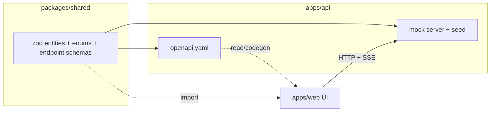
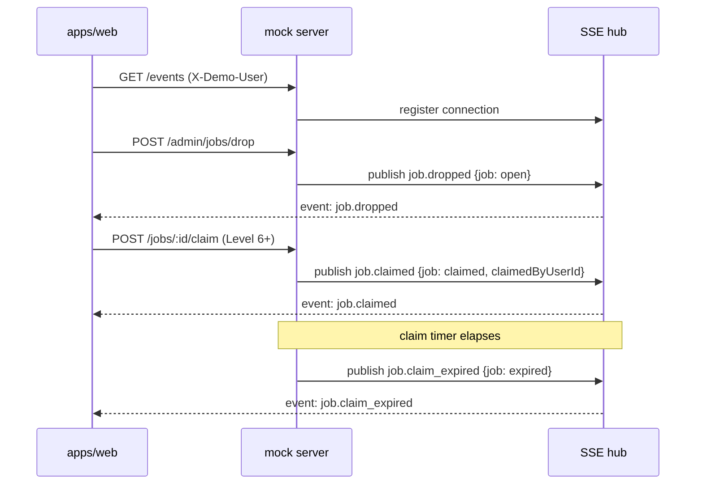

# Design Document

## Overview

`api-contract` is build-plan spec #1 from `/docs/architecture.md`: the dependency-free contract layer every other spec builds against. It produces three artifacts and nothing else:

1. **`/packages/shared`** — zod schemas + inferred TypeScript types: the eight entities, shared enums, the canonical error envelope, and a Request/Response schema pair per endpoint. Both `apps/api` and `apps/web` import from here; neither imports the other.
2. **`/apps/api/openapi.yaml`** — an OpenAPI 3 document describing every endpoint, generated from the zod schemas so the two can never drift.
3. **a mock server** started by `npm run mock` — an Express app serving seeded, schema-valid data for every endpoint plus the `/events` SSE stream, requiring no DB, Docker, GitHub, or Bedrock.

This design conforms to the reconciled `/docs/architecture.md` (data model §3, module boundaries §2, state machines §5, security model §6, mocks §7) as updated on 2026-10-24. The attempt enum follows the architecture (C1); the job enum, escrow field, claim fields, entity set, user fields, and event names follow the reconciled decisions (C2–C6).

## Architecture

### Package and directory layout

```
packages/shared/
  package.json            # name "@sidequest/shared", exports ./ -> dist or src
  tsconfig.json
  src/
    index.ts              # barrel: re-exports everything below
    enums.ts              # attemptStatus, jobStatus, escrowStatus, hintPersona, errorCode
    error.ts              # errorEnvelopeSchema + helper
    entities/
      user.ts  company.ts  simCompany.ts  ticket.ts
      attempt.ts  hintLog.ts  telemetryEvent.ts  job.ts
    endpoints/
      users.ts  tickets.ts  attempts.ts  ai.ts  jobs.ts  admin.ts  events.ts
    events.ts             # SSE event name + payload schemas

apps/api/
  openapi.yaml            # OpenAPI 3, components mirror packages/shared
  package.json            # "mock" script -> runs the mock server
  src/mock/
    server.ts             # Express app, routes, SSE hub
    seed.ts               # deterministic Seed_Data
    demoUser.ts           # // MOCK X-Demo-User resolution
    openapi.ts            # optional: generate openapi.yaml from zod (zod-to-openapi)
```

The `apps/api/openapi.yaml` is the only file this spec places under `apps/api` besides the mock server; the real API modules (`users`, `tickets`, …) are produced by the downstream `core-api` and `marketplace` specs and are out of scope here.

### Data-flow



The single source of truth is `packages/shared`. `openapi.yaml` is derived from it (via `@asteasolutions/zod-to-openapi` or hand-kept in lockstep with a parity check), and the mock server validates its responses against the same schemas. The UI imports types directly from `@sidequest/shared` and talks HTTP/SSE to the mock server.

## Components and Interfaces

### 1. Shared enums (`enums.ts`)

Each enum is declared once and reused everywhere.

```ts
import { z } from "zod";

export const attemptStatus = z.enum([
  "in_progress", "grading", "passed", "changes_requested", "abandoned",
]); // architecture §5 (C1)

export const jobStatus = z.enum([
  "open", "claimed", "submitted", "accepted", "paid", "expired",
]); // reconciled §5 (C2)

export const escrowStatus = z.enum(["funded", "released", "refunded"]); // MOCK (C2)

export const hintPersona = z.enum(["pm", "coach"]); // (C5)

export const errorCode = z.enum([
  "validation_error", "not_found", "level_gate",
  "job_already_claimed", "unauthorized", "conflict", "internal",
]);

export type AttemptStatus = z.infer<typeof attemptStatus>;
export type JobStatus = z.infer<typeof jobStatus>;
export type EscrowStatus = z.infer<typeof escrowStatus>;
export type HintPersona = z.infer<typeof hintPersona>;
export type ErrorCode = z.infer<typeof errorCode>;
```

### 2. Error envelope (`error.ts`)

```ts
export const errorEnvelope = z.object({
  error: z.object({
    code: errorCode,           // stable machine code, never a free-form string
    message: z.string(),       // human-readable; carries no secret material (§6)
  }),
});
export type ErrorEnvelope = z.infer<typeof errorEnvelope>;
```

Every documented non-2xx response in `openapi.yaml` references this schema, and every non-2xx mock response returns a body matching it.

### 3. Entity schemas (`entities/*.ts`)

All eight entities. Field names and types follow the reconciled `/docs/architecture.md` §3.

```ts
// user.ts
export const user = z.object({
  id: z.string(),
  handle: z.string(),
  name: z.string(),
  school: z.string(),
  xp: z.number().int().nonnegative(),
  level: z.number().int().nonnegative(),
  rating: z.number().min(0).max(5),
  workAuthorized: z.boolean(),
  telemetryOptIn: z.boolean(),          // C4: not optInProfile
});

// company.ts
export const company = z.object({
  id: z.string(), name: z.string(), size: z.string(),
});

// simCompany.ts
export const simCompany = z.object({
  id: z.string(), name: z.string(), repoTemplateUrl: z.string().url(),
});

// ticket.ts — Public_Ticket_View: NO hiddenTestRef (§6, Req 7.3)
export const ticket = z.object({
  id: z.string(),
  simCompanyId: z.string(),
  level: z.number().int().positive(),
  title: z.string(),
  description: z.string(),
  acceptanceCriteria: z.array(z.string()).min(1),
  branch: z.string(),
});

// attempt.ts
export const attempt = z.object({
  id: z.string(),
  userId: z.string(),
  ticketId: z.string(),
  status: attemptStatus,
  prUrl: z.string().url().nullable(),
  testRuns: z.number().int().nonnegative(),
  reviewRounds: z.number().int().nonnegative(),
  hintsUsed: z.number().int().nonnegative(),
});

// hintLog.ts
export const hintLog = z.object({
  id: z.string(),
  attemptId: z.string(),
  persona: hintPersona,
  question: z.string(),
  response: z.string(),
});

// telemetryEvent.ts
export const telemetryEvent = z.object({
  id: z.string(),
  userId: z.string(),
  type: z.string(),
  payload: z.record(z.string(), z.unknown()),
  createdAt: z.string().datetime(),
});

// job.ts
export const job = z.object({
  id: z.string(),
  companyId: z.string(),
  title: z.string(),
  description: z.string(),
  payCents: z.number().int().nonnegative(),
  timeLimitHours: z.number().int().positive(),
  minLevel: z.number().int().nonnegative(),
  status: jobStatus,
  claimedByUserId: z.string().nullable(),       // C6: claim lives on Job
  claimExpiresAt: z.string().datetime().nullable(),
  escrowStatus: escrowStatus,                   // MOCK (C2); no EscrowTransaction entity
});
```

`Ticket` deliberately has no `hiddenTestRef` field — it cannot be serialized because it does not exist in the client-facing schema, so a leak fails type-check (§6 hidden-test isolation).

### 4. Endpoint schemas (`endpoints/*.ts`)

One Request/Response pair per endpoint. Representative examples:

```ts
// users.ts
export const getMeResponse = user;
export const getUserResponse = user;                       // public profile view
export const updateOptInRequest = z.object({ telemetryOptIn: z.boolean() });
export const updateOptInResponse = user;

// tickets.ts
export const listTicketsResponse = z.array(ticket);
export const getTicketResponse = ticket;

// attempts.ts
export const startAttemptRequest = z.object({ ticketId: z.string() });
export const startAttemptResponse = attempt;               // status: in_progress
export const submitAttemptRequest = z.object({ prUrl: z.string().url() });
export const submitAttemptResponse = attempt;              // status: grading
export const getAttemptResponse = attempt;

// ai.ts  (pm and coach share the shape)
export const askPersonaRequest = z.object({
  question: z.string().min(1),
  attemptId: z.string().optional(),
});
export const askPersonaResponse = z.object({
  persona: hintPersona,
  question: z.string(),
  response: z.string(),
});

// jobs.ts
export const listJobsResponse = z.array(job);
export const postJobRequest = z.object({
  companyId: z.string(), title: z.string(), description: z.string(),
  payCents: z.number().int().nonnegative(),
  timeLimitHours: z.number().int().positive(),
  minLevel: z.number().int().nonnegative(),
});
export const postJobResponse = job;
export const claimJobResponse = job;                       // claimedByUserId/claimExpiresAt set
export const submitJobRequest = z.object({ prUrl: z.string().url() });
export const submitJobResponse = job;
export const acceptJobResponse = job;                      // escrowStatus -> released, status -> paid

// admin.ts
export const dropDemoJobResponse = job;                    // status: open
```

### 5. SSE event schemas (`events.ts`)

```ts
export const sseEventName = z.enum(["job.dropped", "job.claimed", "job.claim_expired"]);

export const jobDroppedPayload = z.object({ type: z.literal("job.dropped"), job });
export const jobClaimedPayload = z.object({
  type: z.literal("job.claimed"), job, claimedByUserId: z.string(),
});
export const jobClaimExpiredPayload = z.object({
  type: z.literal("job.claim_expired"), job,   // job.status is now "expired"
});
export const sseEvent = z.discriminatedUnion("type", [
  jobDroppedPayload, jobClaimedPayload, jobClaimExpiredPayload,
]);
```

### 6. Endpoint catalogue

The complete HTTP surface documented in `openapi.yaml` and served by the mock. `auth` column = requires `X-Demo-User` current user (`// MOCK`).

| Method | Path | Request | Success | Error cases | Auth |
|--------|------|---------|---------|-------------|------|
| GET | `/users/me` | — | `200 User` | `401 unauthorized` | yes |
| GET | `/users/:id` | path id | `200 User` (public) | `404 not_found` | no |
| PATCH | `/users/me` | `{ telemetryOptIn }` | `200 User` | `400 validation_error` | yes |
| GET | `/tickets` | — (filtered by my level) | `200 Ticket[]` | — | yes |
| GET | `/tickets/:id` | path id | `200 Ticket` | `404 not_found` | no |
| POST | `/attempts` | `{ ticketId }` | `201 Attempt` (in_progress) | `400`, `404 not_found` | yes |
| POST | `/attempts/:id/submit` | `{ prUrl }` | `200 Attempt` (grading) | `400 validation_error`, `404` | yes |
| GET | `/attempts/:id` | path id | `200 Attempt` | `404 not_found` | yes |
| POST | `/ai/pm` | `{ question, attemptId? }` | `200 AskPersonaResponse` | `400 validation_error` | yes |
| POST | `/ai/coach` | `{ question, attemptId? }` | `200 AskPersonaResponse` | `400 validation_error` | yes |
| GET | `/jobs` | — | `200 Job[]` | — | no |
| POST | `/jobs` | `PostJobRequest` | `201 Job` (open) | `400 validation_error` | yes |
| POST | `/jobs/:id/claim` | — | `200 Job` (claimed) | `403 level_gate`, `409 job_already_claimed`, `404` | yes |
| POST | `/jobs/:id/submit` | `{ prUrl }` | `200 Job` (submitted) | `400`, `404`, `409 conflict` | yes |
| POST | `/jobs/:id/accept` | — | `200 Job` (paid, escrow released) | `404`, `409 conflict` | yes |
| POST | `/admin/jobs/drop` | — | `201 Job` (open) + emits `job.dropped` | — | demo-only |
| GET | `/events` | — | `200 text/event-stream` | — | yes |

### 7. Mock server (`apps/api/src/mock/server.ts`)

- **Express** app with `express.json()`, a `// MOCK` `X-Demo-User` middleware, and one handler per route above.
- **Validation:** each route parses its Request_Schema with `.safeParse`; on failure returns `400` + `{ error: { code: "validation_error", message } }`.
- **Response integrity:** handlers construct responses from Seed_Data and `.parse` them against the Response_Schema before sending, so the mock can never emit a shape the contract forbids (and `hiddenTestRef` is structurally impossible).
- **SSE hub:** `GET /events` sets `Content-Type: text/event-stream`, registers the connection, and streams events. `POST /admin/jobs/drop` pushes a `job.dropped`; claiming a job pushes `job.claimed`; a per-claim timer (or a seeded demo timer) pushes `job.claim_expired` and flips the job to `expired`.
- **One command:** `apps/api/package.json` `"scripts": { "mock": "tsx src/mock/server.ts" }`, so `npm run mock` (run in `apps/api`, or `npm run mock -w apps/api` from root) starts it on a fixed port (e.g. 4000).
- **No external deps:** pure in-memory; no DB/Docker/GitHub/Bedrock.



### 8. Demo-user resolution (`demoUser.ts`) — `// MOCK`

```ts
// MOCK: resolve current user from X-Demo-User header; real auth replaces this seam
// behind the same "resolve current user" contract (architecture §7).
export function resolveDemoUser(req, seed) {
  const handle = req.header("X-Demo-User") ?? DEFAULT_DEMO_USER_HANDLE;
  return seed.users.find(u => u.handle === handle) ?? seed.users[0];
}
```

## Data Models

The contract's entity set is exactly the eight client-facing entities (User, Company, SimCompany, Ticket, Attempt, HintLog, TelemetryEvent, Job). The architecture's server-only/internal entities (`GradeRun`, `Review`, `Persona`, `Submission`) are not part of the client contract and are owned by downstream specs; `pm`/`coach` surface as the `hintPersona` enum rather than a client `Persona` entity. Escrow and claim are **fields on `Job`**, not separate entities, per C2/C6.

### Seed data (`seed.ts`)

Deterministic, realistic, satisfying Req 5.4:

- **Users:** `ada` (level 3, below gate), `grace` (level 7, at/above gate); both with school, rating, `workAuthorized`, `telemetryOptIn`.
- **Companies:** `Northwind` (size "mid").
- **SimCompanies:** `Brightline` → `repoTemplateUrl` of `sim-companies/brightline`.
- **Tickets:** three for Brightline at levels 1/2/3 (pagination bug, timezone ETA bug, routes ETA feature — mirroring sandbox-brightline), each with `simCompanyId`, no `hiddenTestRef`.
- **Attempts:** one for `ada` on the L1 ticket in `in_progress`.
- **Jobs:** two for `Northwind` — one `open` (minLevel 6), one `claimed` by `grace` with a near-future `claimExpiresAt` to demo expiry; `escrowStatus` `funded`.

## Error Handling

| Condition | Status | `code` |
|-----------|--------|--------|
| Request body/params fail zod parse | 400 | `validation_error` |
| Unknown id (`/users/:id`, `/tickets/:id`, `/attempts/:id`, `/jobs/:id/*`) | 404 | `not_found` |
| Claim by user below Level 6 | 403 | `level_gate` |
| Claim of an already-claimed job (FCFS loser) | 409 | `job_already_claimed` |
| Submit/accept in a non-permitted job state | 409 | `conflict` |
| No resolvable current user on an auth endpoint | 401 | `unauthorized` |

All bodies are `{ error: { code, message } }`; messages carry no secret material (§6). The mock never logs or returns credentials (none exist in the mock).

## Testing Strategy

Contract-level, lightweight (hackathon scope):

- **Schema self-check:** a small script/test asserts each Response_Schema `.parse`s its corresponding seed value, so the seed is contract-valid by construction.
- **OpenAPI↔zod parity:** if `openapi.yaml` is generated from zod, generation is the check; if hand-kept, a parity test asserts every endpoint in the catalogue appears in `openapi.yaml` with matching component schemas, and that no response component contains `hiddenTestRef`.
- **Mock smoke:** start the mock, hit each endpoint once, assert 2xx + schema-valid body, and assert `/events` emits `job.dropped` after `POST /admin/jobs/drop`.
- **Hidden-test isolation guard:** a test greps the shared `Ticket`/response schemas and the generated OpenAPI for `hiddenTestRef` and fails if found.

Tests are written only after this design and the tasks are approved, per the plan-first workflow.

## Conformance to `/docs/architecture.md`

- **§2 module boundaries:** schema names and endpoint groupings map 1:1 onto the `users`, `tickets`, `attempts`, `ai-personas`, `marketplace`, and `events` modules; the contract introduces no business logic.
- **§3 data model:** entities, field names, and types match the reconciled model (change log 2026-10-24).
- **§5 state machines:** Attempt enum verbatim; Job enum + escrow/claim fields per the reconciled machine.
- **§6 security:** `Ticket` omits `hiddenTestRef`; error envelope carries no secrets; mock needs no credentials.
- **§7 mocks:** `X-Demo-User` and `escrowStatus`/payout are the only mocks, both `// MOCK`, both naming their production replacement seam.
```
