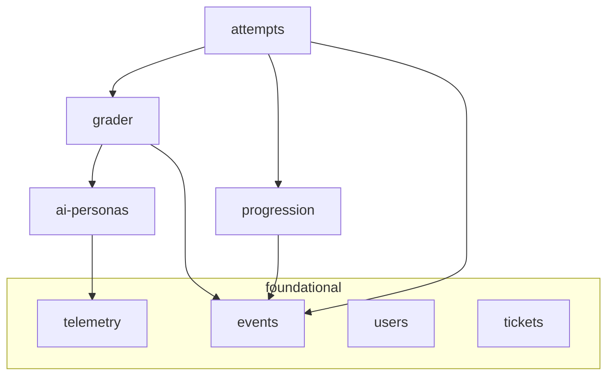
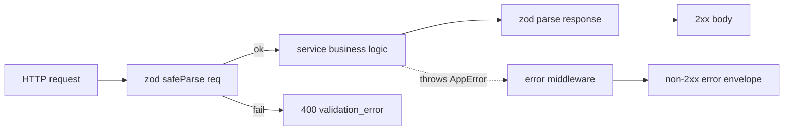
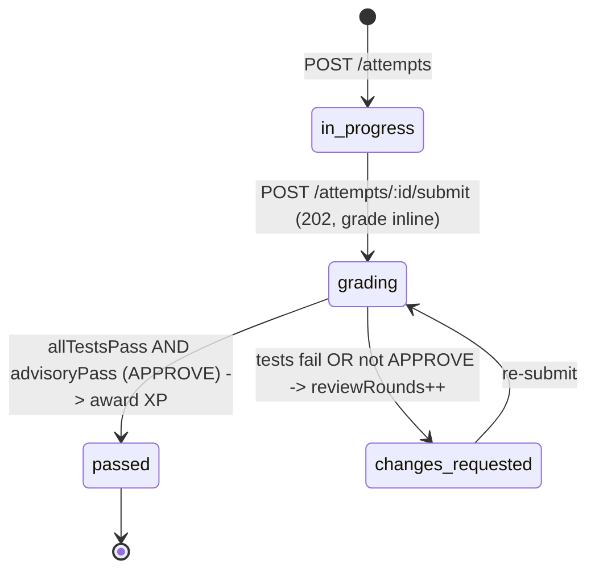

# Design Document

## Overview

`core-api` is build-plan spec #4 from `/docs/architecture.md`: the real Express + TypeScript API that implements the SideQuest learning loop on top of the frozen `api-contract`. It wires seven feature modules (`users`, `tickets`, `attempts`, `ai-personas`, `progression`, `telemetry`, `events`) plus the consumed `grader` seam over a Prisma + SQLite data model, reusing the `/packages/shared` zod contract and the existing `LLMProvider` seam in `apps/api/src/llm`.

Scope boundaries, restated from requirements:

- **In scope:** the Prisma schema + SQLite, the seven modules, the grader seam interface with a **subprocess runner** (demo-critical path), a deterministic seed (three demo users + Brightline tickets from the hidden repo), and a curl smoke script for the Maya loop.
- **Out of scope:** the `marketplace` module (jobs/claims/escrow/payouts) and the `injection-hook` — downstream specs #5 and #6.

### Option B — demo-critical path

This design is built for the **demo-critical path (Option B)**:

- **Grading is synchronous.** `POST /attempts/:id/submit` runs the grade inline and returns the resolved attempt. The design keeps the architecture's `202`-on-submit contract available but the demo path resolves within the request; see "Grade pipeline". The in-process **job queue is deferred** — not built in this spec.
- **Runner is the subprocess runner.** The default `GraderRunner` is a `SubprocessRunner` that runs the hidden tests in a local subprocess with best-effort caps (§9 Docker-unavailable fallback), selected by `GRADER_RUNNER=subprocess`.
- **Docker runner is the LAST task and `[CUTTABLE]`.** The real `DockerRunner` (grader spec #3) plugs in behind the same `GraderRunner` interface and is added only if time allows.
- **Reviewer is real Gemini, not mock.** `LLM_PROVIDER=gemini` with `GEMINI_MODEL=gemini-3.8-flash`; the reviewer uses the live model so the APPROVE / request-changes advisory is genuine. `GEMINI_API_KEY` / `GITHUB_TOKEN` live in `.env`, managed by the operator — this spec never creates or edits `.env`.
- **`*` tests are deferred.** The optional check/test sub-tasks are dropped from the critical path; the single end-to-end smoke test is the verification.

This design conforms to the reconciled `/docs/architecture.md` (§2 boundaries, §3 data model, §4 sequences, §5 state machines, §6 security, §7 mocks, §8 build plan, §9 risks) and to the frozen `/packages/shared` contract. Where the user task's field names differed (`optInProfile`, `state`), the contract names win (`telemetryOptIn`, `status`) per requirements "Contract conformance".

## Architecture

### Directory layout

```
apps/api/
  package.json                 # + prisma, @prisma/client; scripts: dev, seed, smoke, prisma:*
  prisma/
    schema.prisma              # SQLite datasource; models per architecture §3
    seed.ts                    # loads tickets.json + 3 demo users (npm run seed)
  src/
    db.ts                      # PrismaClient singleton
    env.ts                     # env read + startup credential check (§6)
    app.ts                     # Express app: mounts every module router + error middleware
    server.ts                  # dev entrypoint (npm run dev): app.listen(PORT)
    http/
      error.ts                 # AppError + error-mapping middleware -> { error: { code, message } }
      validate.ts              # zod safeParse helper -> 400 validation_error
    modules/
      users/        { routes.ts, service.ts, schema.ts }   # // MOCK resolveDemoUser
      tickets/      { routes.ts, service.ts, schema.ts }
      attempts/     { routes.ts, service.ts, schema.ts }
      ai-personas/  { routes.ts, service.ts, schema.ts }
      progression/  { service.ts }                          # no routes (internal)
      telemetry/    { service.ts }                          # side channel (internal)
      events/       { routes.ts, service.ts }               # GET /events SSE hub
      grader/       { service.ts, runner.ts, types.ts }     # seam + demo runner
  scripts/
    smoke.sh                   # curl full-loop smoke test as Maya (npm run smoke)
  src/llm/ ...                 # EXISTING LLMProvider seam (reused, unchanged)

sim-companies/brightline-hidden/tickets.json   # EXISTING: ticket defs + hiddenTestPath (read at seed)
```

Only `apps/api` is touched (plus the pre-existing `packages/shared`, imported). The mock server under `apps/api/src/mock` from `api-contract` is left in place; `core-api` adds the real app alongside it and does not depend on it.

### Module dependency direction (acyclic, per §2)



Edges point only toward foundational/leaf modules (`users`, `tickets`, `telemetry`, `events`, `ai-personas`). `attempts` is the only orchestrator; it delegates grading to `grader`, XP to `progression`, and publishes to `events`. No module both depends on and is depended on by the same counterpart — no cycle.

### Request/response pipeline

Every route is thin: parse with a Shared_Contract schema → call the service → serialize the result through the response schema → send. A single Express error middleware maps thrown `AppError`s (and zod failures) to `{ error: { code, message } }`.



## Data model (Prisma over SQLite)

Models mirror architecture §3. SQLite has no native enum or JSON column, so enums are stored as `String` (validated at the edge by the shared zod enums) and JSON props as `String` (serialized). This keeps the schema Postgres-compatible: the later migration swaps `String` enum columns for Postgres enums and `String` JSON for `jsonb` without changing the service code, which already round-trips through zod.

```prisma
// datasource: sqlite; generator: prisma-client-js

model User {
  id             String   @id @default(cuid())
  handle         String   @unique            // resolved from X-Demo-User (// MOCK)
  name           String
  school         String
  xp             Int      @default(0)
  level          Int      @default(1)
  rating         Float    @default(0)
  workAuthorized Boolean  @default(false)
  telemetryOptIn Boolean  @default(false)     // opt-in OFF by default (§6)
  createdAt      DateTime @default(now())
  attempts        Attempt[]
  telemetryEvents TelemetryEvent[]
}

model SimCompany {
  id              String   @id @default(cuid())
  name            String
  repoTemplateUrl String
  tickets         Ticket[]
}

model Ticket {
  id                 String   @id            // e.g. "brightline-l1-pagination"
  simCompanyId       String
  simCompany         SimCompany @relation(fields: [simCompanyId], references: [id])
  repo               String
  level              Int
  title              String
  description        String
  acceptanceCriteria String   // JSON array (string[]) serialized
  branch             String
  difficulty         String
  xpReward           Int
  hiddenTestRef      String   // SERVER-ONLY: never serialized to a client (§6)
  createdAt          DateTime @default(now())
  attempts           Attempt[]
}

model Attempt {
  id            String   @id @default(cuid())
  userId        String
  user          User     @relation(fields: [userId], references: [id])
  ticketId      String
  ticket        Ticket   @relation(fields: [ticketId], references: [id])
  branch        String?
  prUrl         String?
  status        String   @default("in_progress") // Attempt state machine (§5)
  testRuns      Int      @default(0)
  reviewRounds  Int      @default(0)
  hintsUsed     Int      @default(0)
  startedAt     DateTime @default(now())
  updatedAt     DateTime @updatedAt
  gradeRuns     GradeRun[]
  review        Review?
  hintLogs      HintLog[]
}

model GradeRun {
  id          String   @id @default(cuid())
  attemptId   String
  attempt     Attempt  @relation(fields: [attemptId], references: [id])
  passed      Boolean
  testsPassed Int
  testsTotal  Int
  logExcerpt  String   // bounded, sanitized (never hidden-test source) (§6)
  durationMs  Int
  createdAt   DateTime @default(now())
}

model Persona {
  id           String   @id            // "pm" | "coach"
  name         String
  voice        String
  systemPrompt String
  reviews      Review[]
}

model Review {
  id           String   @id @default(cuid())
  attemptId    String   @unique         // Attempt 1:1 (optional) Review
  attempt      Attempt  @relation(fields: [attemptId], references: [id])
  personaId    String
  persona      Persona  @relation(fields: [personaId], references: [id])
  summary      String
  commentsJson String
  advisoryPass Boolean
  createdAt    DateTime @default(now())
}

model HintLog {
  id        String   @id @default(cuid())
  attemptId String
  attempt   Attempt  @relation(fields: [attemptId], references: [id])
  persona   String   // "pm" | "coach"
  question  String
  response  String
  createdAt DateTime @default(now())
}

model TelemetryEvent {
  id        String   @id @default(cuid())
  userId    String
  user      User     @relation(fields: [userId], references: [id])
  name      String   // event type
  propsJson String   // bounded, anonymized, no PII (§6)
  createdAt DateTime @default(now())
}
```

`Company`, `Job`, and `Submission` from §3 are intentionally **not** modeled here — they belong to the downstream `marketplace` spec. Adding them later is additive (new models + relations) and does not alter core-api models.

### Contract vs. storage mapping

The stored model is a superset of the client-facing contract. Services convert rows to Shared_Contract shapes before responding, dropping server-only fields:

| Contract type (`/packages/shared`) | Stored model | Conversion notes |
|---|---|---|
| `user` | `User` | direct field copy; `createdAt` not in contract, omitted |
| `ticket` (Public_Ticket_View) | `Ticket` | **omit** `hiddenTestRef`, `repo`, `difficulty`, `xpReward`; `acceptanceCriteria` JSON-parsed to `string[]` |
| `attempt` | `Attempt` | map `status`, `prUrl`, `testRuns`, `reviewRounds`, `hintsUsed` |
| `askPersonaResponse` | (from `HintLog` fields) | `{ persona, question, response }` |
| `Grade_Result` (internal) | `GradeRun` + `Review` | **never** serialized raw; student sees only counts + `logExcerpt` |

A dedicated `toPublicTicket(row)` mapper is the single point that strips hidden fields, so the omission is enforced in exactly one place and `hiddenTestRef` cannot leak into a response.

## Module designs

### users (`// MOCK` auth, profiles, opt-in, Level 6 gate)

- `service.resolveDemoUser(handle)` — `// MOCK`: looks up the `User` by `handle` from `X-Demo-User`; unknown handle → `unauthorized` (401). Production replacement: real auth middleware behind this same seam (§7). A small Express middleware attaches the resolved `Current_User` to `req` for downstream routes.
- Routes: `GET /users/me` (Current_User), `GET /users/:id` (`not_found` on miss), `PATCH /users/me` (`{ telemetryOptIn }` → flips the flag; the only mutating users route).
- `service.isLevel6OrAbove(userId)` — reads the persisted `level` for the downstream marketplace gate; the gate check lives here but is consumed later.

### tickets (level-filtered public view)

- `service.listForUser(user)` — returns tickets where `ticket.level <= user.level`, mapped through `toPublicTicket`. Level 1 Maya → only `brightline-l1-pagination`.
- `service.getPublic(id)` — single public view; `not_found` on miss.
- Hidden-test refs stay on the row and never enter the mapper output.

### attempts (orchestrator + state machine)

- `POST /attempts` `{ ticketId }`: validates the ticket exists and `ticket.level <= user.level` (`level_gate` if too high, `not_found` if unknown), creates `Attempt{ status: in_progress, counters 0 }`. Optionally creates a GitHub branch behind the GitHub seam; if GitHub is unavailable the attempt still starts (branch recorded as null), honoring the §9 manual-prUrl fallback.
- `POST /attempts/:id/submit` `{ prUrl }`: rejects a submit on a terminal `passed` attempt (`conflict`); otherwise records `prUrl`, sets `status: grading`, increments `testRuns`, runs the grade **inline** (synchronous, Option B), applies the verdict, and returns the **resolved** attempt. The response status is `202` per the contract; with synchronous grading the body is the already-resolved attempt. (The queue is deferred.)
- `GET /attempts/:id`: returns the attempt (contract shape).
- On Grade_Job completion (callback from the grade pipeline): persist `GradeRun` + `Review`, then apply the verdict:



  Verdict rule (Requirement 5.3–5.5): `passed` **iff** `testsTotal > 0 && testsPassed === testsTotal && advisoryPass === true`; otherwise `changes_requested` with `reviewRounds++`. A runner error/timeout yields `passed: false`, so it can only ever land in `changes_requested`. On `passed`, call `progression.awardForAttempt(attempt)`. Publish the attempt-update event through `events` either way.

### grader (seam consumed; demo runner shipped)

- `types.ts`: internal server-only types.

```ts
interface GradeRequest {
  repo: string;
  ref: string;            // PR ref / branch / prUrl-derived
  ticketId: string;
  hiddenTestRef: string;  // server-only, from Ticket.hiddenTestRef
}
interface ReviewAdvisory { summary: string; comments: unknown[]; advisoryPass: boolean; }
interface GradeResult {
  passed: boolean;        // runner-level pass (false on error/timeout)
  testsPassed: number;
  testsTotal: number;
  logExcerpt: string;     // bounded, sanitized
  durationMs: number;
  review: ReviewAdvisory;
}
interface GraderRunner { grade(req: GradeRequest): Promise<GradeResult>; }
```

- `runner.ts`: selects the runner by `GRADER_RUNNER` env (§9). The default for the demo-critical path (Option B) is a **`SubprocessRunner`** (`GRADER_RUNNER=subprocess`) that checks out the submitted PR ref over the GitHub seam, runs the ticket's hidden tests (`hiddenTestRef`) in a local Python subprocess with best-effort memory/CPU/60 s-timeout caps, and parses pytest output into `testsPassed`/`testsTotal` + a bounded, sanitized `logExcerpt`. The real **`DockerRunner`** (owned by the `grader` spec) plugs in behind the same `GraderRunner` interface and is the LAST, `[CUTTABLE]` task — added only if time allows. Either runner then calls `ai-personas` for the Review_Advisory, as in §4(a).
- `service.grade(req)`: thin pass-through to the selected runner; after the subprocess result, invoke `ai-personas` review (live Gemini) to attach the advisory. The grader **never** writes the DB (§2) — it returns the `GradeResult`; `attempts` persists it.

### Grade pipeline (synchronous — Option B)

On the demo-critical path, grading runs **inline** within the submit request: `POST /attempts/:id/submit` records the PR, sets `status=grading`, runs the subprocess grade, applies the verdict, awards XP on a pass, and returns the **resolved** attempt. The architecture's `202`-on-submit remains the contract-level status, but with synchronous grading the client receives the already-resolved attempt (so a `GET /attempts/:id` poll simply confirms the terminal status). The **job queue is deferred** — there is no in-process broker in this spec; it can be reintroduced later without changing the module boundaries.

```mermaid
sequenceDiagram
    participant C as client (curl)
    participant A as attempts
    participant G as grader seam (SubprocessRunner)
    participant GH as GitHub seam
    participant P as ai-personas (Gemini)
    participant PR as progression
    participant E as events

    C->>A: POST /attempts/:id/submit {prUrl}
    A->>A: record prUrl, status=grading, testRuns++
    A->>G: grade(repo, ref, ticket, hiddenTestRef)   (inline)
    G->>GH: checkout PR ref
    G->>G: run hidden tests in subprocess (best-effort caps, 60s)
    G->>P: review(diff, persona)  -> live Gemini advisory
    P-->>G: {summary, advisoryPass}
    G-->>A: GradeResult{passed, counts, review}
    A->>A: persist GradeRun + Review; apply verdict
    alt passed (allTests AND APPROVE)
        A->>PR: awardForAttempt(attempt)
        PR->>E: xp.awarded / level.up
        A->>E: attempt passed
    else changes_requested
        A->>A: reviewRounds++
        A->>E: attempt changes_requested
    end
    A-->>C: Attempt {resolved status}
    C->>A: GET /attempts/:id (poll) -> confirms terminal status
```

### ai-personas (PM clarifies; Coach nudges + logs)

- `POST /ai/pm` and `POST /ai/coach`, body `askPersonaRequest` → `askPersonaResponse`.
- System prompts constrain behavior and reuse `apps/api/src/llm/base.ts#personaSystemPrompt` extended so **PM** answers only from ticket + repo context and clarifies requirements without solutions, and **Coach** gives nudges only — never solution code/diffs/complete fixes. The ticket's acceptance criteria and public description are injected as context; hidden-test material is never in the prompt.
- Coach with an `attemptId`: write a `HintLog{ persona: coach, question, response }` and `attempt.hintsUsed++` in the same transaction (Requirement 6.4). PM does not increment hints (it clarifies requirements, not a coaching nudge) — or, if product prefers, both log; the design logs **coach** hints per the task wording ("Coach … Every message is logged to HintLog and increments hintsUsed").
- All calls go through `createLLMProvider()` with `LLM_PROVIDER=gemini` and `GEMINI_MODEL=gemini-3.8-flash` (the live reviewer, **not** the mock provider); on provider error/timeout, return a clearly-labeled fallback string (§9) so the request still succeeds.

### progression (XP math; owned here)

`awardForAttempt(attempt)` computes and persists atomically:

```
base      = 100
cleanBonus = attempt.hintsUsed === 0 ? 25 : 0
penalty    = 10 * max(0, attempt.reviewRounds - 2)
delta      = base + cleanBonus - penalty
user.xp    = max(0, user.xp + delta)         // XP never negative
user.level = floor(user.xp / 100) + 1
```

Persist `{ xp, level }` in one update. Publish `xp.awarded`; if `level` increased, also `level.up`. `isLevel6OrAbove` reads the persisted `level`. No other module performs this math (§2).

> Worked example (Maya demo): Maya starts Level 1 with `xp` in `[0,100)`, seeded at `xp = 0`. She clears the L1 ticket with `hintsUsed = 0`, `reviewRounds = 0`: `delta = 100 + 25 - 0 = 125` → `xp = 125`, `level = floor(125/100)+1 = 2`. The smoke test asserts `xp` rose by 125 and `level` became 2.

### telemetry (opt-in side channel)

- `record(userId, name, props)`: loads the user, **no-ops** unless `telemetryOptIn === true`; otherwise writes a `TelemetryEvent` with bounded, anonymized `propsJson` (no PII, no secrets). Wrapped so a failure never propagates to the caller's request (fire-and-forget).

### events (SSE hub transport)

- `GET /events`: sets `text/event-stream`, registers the connection in an in-memory subscriber set, heartbeats, and cleans up on close.
- `publish(event)`: fans a payload out to subscribers. Accepts core-api events (`attempt.*`, `xp.awarded`, `level.up`) and, unchanged, the marketplace names (`job.dropped`, `job.claimed`, `job.claim_expired`) so the downstream spec reuses the hub. Payloads for job events follow the Shared_Contract `sseEvent` schema.

## Error handling

A single `AppError { code: ErrorCode; status: number; message: string }` and an Express error middleware produce the canonical envelope. Mapping:

| Condition | HTTP | `code` |
|---|---|---|
| Request fails its zod schema | 400 | `validation_error` |
| Unknown user / ticket / attempt id | 404 | `not_found` |
| Unknown / missing `X-Demo-User` | 401 | `unauthorized` |
| Ticket above the user's level on start | 403 | `level_gate` |
| Submit on a terminal (`passed`) attempt | 409 | `conflict` |
| Unhandled server fault | 500 | `internal` |

Error messages carry no secret material (§6). Credentials are read via `env.ts`; a missing credential for the selected provider throws at startup naming the env var only (`LLMConfigError` already does this for LLM; the GitHub seam mirrors it).

## Security conformance (§6)

- **Hidden-test isolation:** `hiddenTestRef` lives only on the `Ticket` row and in the `GradeRequest`; `toPublicTicket` and every response schema omit it. Grade responses expose only `testsPassed`/`testsTotal`/`logExcerpt` (bounded, sanitized).
- **Secrets:** GitHub PAT and LLM creds from env only; never logged, never in an error body; startup check names a missing var without printing it.
- **Opt-in telemetry:** recorded only when `telemetryOptIn === true`; off by default; no PII.

## Mocks (§7) and fallbacks (§9)

- `// MOCK` `resolveDemoUser` in `users/service.ts` → real auth middleware later.
- `GRADER_RUNNER` selects the `SubprocessRunner` (Option B default) or the `DockerRunner` (grader spec, LAST + `[CUTTABLE]`) behind one `GraderRunner` interface (§9 Docker-unavailable).
- `LLM_PROVIDER=gemini` + `GEMINI_MODEL=gemini-3.8-flash` selects the live Gemini reviewer behind the existing `LLMProvider` seam; AI failures return a labeled fallback (§9 Bedrock-latency). `GEMINI_API_KEY` / `GITHUB_TOKEN` are in `.env`, managed by the operator — this spec never creates or edits `.env`.
- GitHub branch/PR behind a seam with a manual `prUrl` path (§9 GitHub fallback).

## Testing strategy (Option B — deferred)

On the demo-critical path the optional (`*`) unit/contract checks are **deferred**; the single verification is the end-to-end smoke test. The design still parses every route response through its Shared_Contract schema before send (that guard is intrinsic to the route, not an optional test). When time allows, the deferred checks are: progression XP matrix, verdict matrix, hidden-test leak guard, and seed contract-conformance.

- **End-to-end smoke (the verification):** `scripts/smoke.sh` runs the full Maya loop as `X-Demo-User: maya` (start L1 → submit PR → poll → confirm XP up). This is the demo-critical checkpoint.
- **GitHub integration proof (wrong-fix PR):** after all tasks pass, a wrong-fix PR is opened with `gh` against base `ticket/l1-pagination`; the smoke run over that PR must show the hidden tests **failing** and the Gemini review comment posted on GitHub — proving the subprocess runner and live reviewer are wired to a real PR.

## Build-plan conformance (§8)

Dependencies are exactly `api-contract` (consumed as `/packages/shared`) and `grader` (consumed as the `GraderRunner` seam). No dependency points outside the six specs. `marketplace` and `injection-hook` build on the `users`/`progression` gate and the `events` hub produced here, with no change required to core-api.
