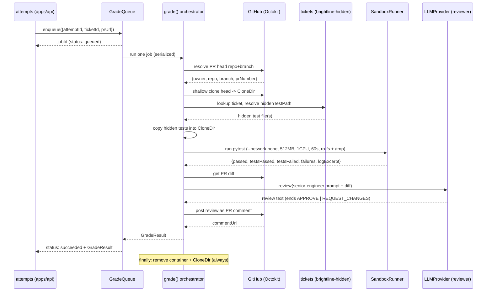

# Design Document

## Overview

The `grader` is a library under `/grader`, consumed by `/apps/api` (the `attempts` module). It grades one submission: given `{ attemptId, ticketId, prUrl }`, it clones the PR head, injects the ticket's hidden tests, runs pytest in a locked-down sandbox, parses results, generates a senior-engineer AI review, posts it on the PR, and returns a `GradeResult`. It touches GitHub (Octokit) and the LLM (the existing `LLMProvider` seam) but never the database — it returns data the caller persists (architecture §2).

Two seams make the grader demo-robust (architecture §7/§9): the **`SandboxRunner`** (Docker default, subprocess fallback, by `GRADER_RUNNER`) and the **`LLMProvider`** (Gemini default / Bedrock / OpenRouter / Mock, by `LLM_PROVIDER`). An **in-process job queue** serializes grading to one job at a time. **Cleanup is guaranteed** via a `finally`-based resource stack that runs on success, error, and timeout.

This design conforms to `/docs/architecture.md` §4(a) (grade sequence), §6 (sandbox limits, secrets, hidden-test isolation), §7 (the two seams), and §9 (fallbacks). The `GradeResult` is the reconciled superset from requirements G1.

## Architecture

### Package layout

```
grader/
  package.json            # "@sidequest/grader", deps: @octokit/rest, zod; reuses @sidequest/api llm seam
  tsconfig.json
  src/
    index.ts              # barrel: grade(), GradeQueue, types
    types.ts              # GradeRequest, GradeResult, Failure, SandboxOutcome
    config.ts             # env resolution (GITHUB_TOKEN, GRADER_RUNNER, LLM_PROVIDER, paths)
    grade.ts              # orchestrator: the 7-step flow + cleanup stack
    github.ts             # Octokit: resolve PR head, shallow clone, get diff, post comment
    tickets.ts            # load tickets.json, resolve hiddenTestPath, copy hidden tests
    report.ts             # parse pytest JSON report -> SandboxOutcome
    reviewer.ts           # senior-engineer prompt + LLMProvider call + verdict parse
    queue.ts              # in-process async job queue + status tracking
    cleanup.ts            # ResourceStack: idempotent, finally-run teardown
    runners/
      types.ts            # SandboxRunner interface + RunSpec
      docker.ts           # DockerRunner (python:3.12-slim, enforced limits)
      subprocess.ts       # SubprocessRunner (best-effort local fallback)
      index.ts            # createSandboxRunner(GRADER_RUNNER)
    smoke.ts              # Requirement 10 smoke script
```

The LLM seam is **reused**, not duplicated: `grader` imports `createLLMProvider` and the `LLMProvider`/`ReviewRequest` types from the existing `/apps/api/src/llm`. (If the monorepo later extracts the seam into `packages/shared` or a dedicated package, only the import path changes.)

### The grade flow (architecture §4a)



## Components and Interfaces

### Types (`types.ts`)

```ts
export interface GradeRequest { attemptId: string; ticketId: string; prUrl: string; }

export interface Failure { test: string; message: string; }   // message bounded

export interface SandboxOutcome {
  passed: boolean;
  testsPassed: number;
  testsFailed: number;
  failures: Failure[];
  logExcerpt: string;      // bounded; never hidden-test source
  timedOut: boolean;
}

export type Verdict = "APPROVE" | "REQUEST_CHANGES";

export interface GradeResult {
  passed: boolean;
  testsPassed: number;
  testsFailed: number;
  testsTotal: number;      // = testsPassed + testsFailed
  failures: Failure[];
  logExcerpt: string;
  verdict: Verdict;
  reviewCommentUrl: string | null;
}
```

`passed === (testsTotal > 0 && testsFailed === 0 && testsPassed === testsTotal)`.

### SandboxRunner seam (`runners/types.ts`)

```ts
export interface RunSpec {
  cloneDir: string;        // student code + injected hidden tests
  reportPath: string;      // where the JSON report is written (under /tmp scratch)
  timeoutMs: number;       // 60_000
  memoryMb: number;        // 512
  cpus: number;            // 1
}
export interface SandboxRunner {
  readonly name: "docker" | "subprocess";
  run(spec: RunSpec): Promise<SandboxOutcome>;  // never throws for test failure; throws only on infra error
}
```

- **DockerRunner** — invokes:
  ```
  docker run --rm --network none --memory 512m --cpus 1 \
    --read-only --tmpfs /tmp \
    -v <cloneDir>:/work:ro  (code copied in, report written to /tmp then read out) \
    -w /work python:3.12-slim \
    sh -c "pip install -q pytest pytest-json-report <ticket deps> && \
           pytest --json-report --json-report-file=/tmp/report.json -q"
  ```
  Because root is read-only, pytest writes only to `/tmp`; the report is emitted to `/tmp/report.json` and read back by copying out before container removal (or via a bind-mounted writable report dir mounted at `/tmp`). The 60 s timeout is enforced by the runner watchdog (kill + reap, then mark `timedOut`). `--rm` plus explicit `docker rm -f` on the cleanup stack guarantees removal.
- **SubprocessRunner** — runs pytest in a throwaway venv in a local temp dir, applying the 60 s timeout via a watchdog and best-effort memory/CPU caps (e.g. `ulimit`/`resource` where available). Same `SandboxOutcome` shape. Selected when `GRADER_RUNNER=subprocess` or when `DockerRunner` init fails (architecture §9 fallback).
- **`createSandboxRunner()`** reads `GRADER_RUNNER` (default `docker`); on `docker` it probes `docker info` and falls back to subprocess if unreachable.

### GitHub (`github.ts`) — Octokit

- `resolvePrHead(prUrl)` → parse `owner/repo/pull/number`, `pulls.get` → `{ headOwner, headRepo, headBranch, number }`.
- `shallowClone(head, dir)` → `git clone --depth 1 --branch <branch> https://x-access-token:<token>@github.com/<owner>/<repo>.git <dir>` (token injected only into the clone URL, never logged; the remote is then stripped).
- `getDiff(prUrl)` → `pulls.get` with `mediaType: { format: "diff" }`.
- `postComment(prUrl, body)` → `issues.createComment` → returns `html_url`.
- All failures map to grader errors that name the condition but never the token (Req 2, 11).

### Tickets (`tickets.ts`)

- `loadTicket(ticketId)` → read/parse `/sim-companies/brightline-hidden/tickets.json`, find by `id`; throw a named error if absent (Req 3.3).
- `copyHiddenTests(ticket, cloneDir)` → resolve `hiddenTestPath` under `brightline-hidden/`; verify existence (Req 3.4); copy into the clone so pytest discovers it (e.g. into the repo's `tests/` dir). The path to the hidden source is server-side only and never emitted.

### Report parsing (`report.ts`)

- `parseReport(reportPath)` → read the pytest JSON report, derive `testsPassed`, `testsFailed`, `failures[]` (node id + bounded message), `passed`, and a bounded `logExcerpt`. Zero tests executed ⇒ `passed=false` (Req 4.6). Missing/unparseable ⇒ failed with a diagnostic excerpt (Req 5.4). Failure messages are sanitized/truncated so no hidden-test source is surfaced (Req 3.6, 11.5).

### Reviewer (`reviewer.ts`)

System prompt (fixed contract, Req 6.3):

> You are a senior software engineer reviewing a pull request on THIS codebase. Be specific and always reference `file:line`. Point out bugs, missed edge cases, and style issues that matter for this codebase. Do NOT write the fix or provide corrected code. End your review with a single final line that is EXACTLY `APPROVE` or `REQUEST_CHANGES`.

- `review({ diff, ticket, outcome })` builds `[system, user]` messages (user = PR diff + brief ticket context) and calls `LLMProvider.complete(...)` via `createLLMProvider()`.
- `parseVerdict(text)` → take the last non-empty line; if it is exactly `APPROVE` or `REQUEST_CHANGES`, use it; else fall back to `outcome.passed ? "APPROVE" : "REQUEST_CHANGES"` and flag `modelVerdictMissing` (Req 6.5).
- On LLM error/timeout → a clearly-labeled canned review + test-derived verdict (Req 6.7, architecture §9). Never includes credentials (Req 6.8).

### Job queue (`queue.ts`)

```ts
type JobStatus = "queued" | "running" | "succeeded" | "failed";
interface JobRecord { id: string; status: JobStatus; result?: GradeResult; error?: string; }

class GradeQueue {
  enqueue(req: GradeRequest): string;          // returns jobId, status queued
  status(jobId: string): JobRecord | undefined;
  // internal: a single-consumer loop runs jobs FIFO, one at a time
}
```

A promise-chain / single worker loop guarantees one concurrent job; others wait in `queued` and start in submission order (Req 8.1, 8.5). Status queries are synchronous reads of an in-memory map (Req 8.6). Errors are stored as bounded strings, never secrets (Req 8.4).

### Cleanup (`cleanup.ts`)

```ts
class ResourceStack {
  defer(fn: () => Promise<void> | void): void;  // LIFO
  async dispose(): Promise<void>;                // idempotent; swallows already-gone errors
}
```

`grade()` creates a `ResourceStack`, defers temp-dir removal and container removal as soon as each is created, and calls `dispose()` in a `finally` so cleanup runs on success, thrown error, and timeout (Req 9). Container removal uses `docker rm -f <id>` (idempotent) in addition to `--rm`.

### Orchestrator (`grade.ts`)

```ts
export async function grade(req: GradeRequest): Promise<GradeResult> {
  const stack = new ResourceStack();
  try {
    const head = await resolvePrHead(req.prUrl);
    const dir = await mkdtemp(); stack.defer(() => rm(dir));
    await shallowClone(head, dir);
    const ticket = loadTicket(req.ticketId);
    copyHiddenTests(ticket, dir);
    const runner = createSandboxRunner();          // registers container removal on stack
    const outcome = await runner.run({ cloneDir: dir, /* limits */ });
    const diff = await getDiff(req.prUrl);
    const review = await reviewer.review({ diff, ticket, outcome });
    const commentUrl = await postComment(req.prUrl, review.text).catch(() => null);
    return toGradeResult(outcome, review.verdict, commentUrl);
  } finally {
    await stack.dispose();                          // always
  }
}
```

## Error Handling

| Stage | Condition | Behavior |
|-------|-----------|----------|
| Config | Missing `GITHUB_TOKEN` / LLM creds for selected provider | Fail naming the missing env var; no secret printed (Req 11.3) |
| PR resolve | Invalid PR URL / not found | Fail, named condition, no token (Req 2.3) |
| PR resolve | Octokit rate-limit/auth error | Fail, named condition, no token (Req 2.4) |
| Ticket | `ticketId` absent | Fail naming ticketId; skip sandbox (Req 3.3) |
| Ticket | `hiddenTestPath` missing on disk | Fail naming path; skip sandbox (Req 3.4) |
| Sandbox | Docker init fails | Fall back to subprocess (Req 4.8) |
| Sandbox | Timeout (>60 s) | Kill+reap, `timedOut=true`, report failed (Req 4.4) |
| Sandbox | Zero tests executed | `passed=false` (Req 4.6) |
| Report | Missing/unparseable | Failed + bounded diagnostic excerpt (Req 5.4) |
| Review | LLM error/timeout | Canned fallback review + test-derived verdict (Req 6.7) |
| Review | No valid verdict line | Derive verdict from test outcome (Req 6.5) |
| Comment | Post fails | `reviewCommentUrl = null`, still return result (Req 7.3) |
| Any stage | Error raised | Cleanup runs before propagation (Req 9.3) |

No error path emits a credential or hidden-test source (Req 11).

## Testing Strategy

- **Unit (hermetic):** `report.ts` parsing (pass/fail/zero-tests/unparseable), `reviewer.parseVerdict` (valid/invalid/missing final line), `GradeQueue` serialization and status transitions, `ResourceStack` idempotent LIFO dispose. LLM and Octokit are stubbed; `LLM_PROVIDER=mock` is used for review tests.
- **Runner contract:** run both `DockerRunner` (when Docker is up) and `SubprocessRunner` against a tiny fixture repo asserting identical `SandboxOutcome` shape; assert `timedOut` on a sleep fixture.
- **Smoke (Requirement 10):** `grader/src/smoke.ts` grades a real PR against the L1 ticket and prints the `GradeResult`; honors `GRADER_RUNNER`/`LLM_PROVIDER` so it runs with subprocess + mock when Docker or a live LLM is unavailable.

Tests are written only after this design and tasks are approved (plan-first workflow).

## Conformance to `/docs/architecture.md`

- **§2 boundaries:** no DB access, no attempt/progression mutation — returns `GradeResult` only.
- **§4a sequence:** matches the grade → sandbox → review → result flow exactly.
- **§6 security:** `--network none`, 512 MB, 1 CPU, 60 s kill-on-timeout, read-only root + `/tmp` scratch, non-root where possible, disposable container; secrets env-only, never logged/returned; hidden tests never serialized.
- **§7 seams:** `SandboxRunner` (Docker/subprocess by `GRADER_RUNNER`) and `LLMProvider` (reused, by `LLM_PROVIDER`).
- **§9 fallbacks:** Docker→subprocess, LLM→canned review, GitHub errors named without token, timeout⇒failed.
- **G1:** `GradeResult` superset carries the architecture fields (`passed`, `testsPassed`, `testsTotal`, `logExcerpt`) plus additive demo fields (`testsFailed`, `failures`, `verdict`, `reviewCommentUrl`).
```
