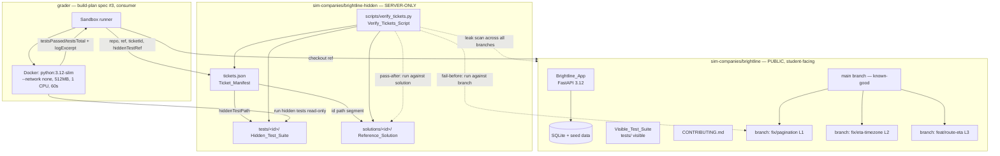

# Design Document

## Overview

This design covers build-plan spec #2 (`sandbox-brightline`) from `/docs/architecture.md`: the two repositories under `/sim-companies` that make up the SideQuest practice sandbox.

- **`sim-companies/brightline`** — the public, student-facing Python 3.12 FastAPI application for "Brightline Logistics" (shipments, drivers, routes), backed by SQLite with seed data, with a visible test suite that passes on `main`, deliberate realistic imperfections, and a `CONTRIBUTING.md`. It contains **no** hidden tests, reference solutions, or ticket manifest.
- **`sim-companies/brightline-hidden`** — the **server-only** repository holding `tickets.json` (the `Ticket_Manifest`), the hidden pytest suites, the reference solutions, and `scripts/verify_tickets.py`. Nothing here is ever shipped to students.

The **highest-priority deliverable is the frozen `tickets.json` schema and the hidden-test folder layout**, because the grader (build-plan spec #3) consumes this contract directly. This design freezes those artifacts first, with explicit field names, types, and on-disk layout.

This is a **planning-only** spec. It produces no application code; downstream work implements it. Everything here conforms to `/docs/architecture.md`, which governs on any conflict (see the "Relationship to /docs/architecture.md" section).

### Design decisions and rationale

- **Manifest-first, path-based asset resolution.** Every ticket's hidden test and reference solution are located deterministically from `tickets.json` by embedding the ticket `id` as a path segment. This gives the grader a single contract to resolve `(repo, ref, ticketId, hiddenTestRef)` without scanning.
- **`hiddenTestPath` is the on-disk realization of `Ticket.hiddenTestRef`.** The architecture names a server-only `hiddenTestRef` reference. In this sandbox that reference is concretely a repo-relative path within `brightline-hidden`. This is a realization of the architecture field, not a divergence (documented in the data-model mapping).
- **The verifier is the single source of truth for soundness.** `verify_tickets.py` validates the schema, resolves layout, enforces isolation, and proves fail-before / pass-after for every ticket in one run — matching Requirements 1, 2, 7, 9, 10, 11, 12, 13.

## Architecture

The two repos are static assets. `brightline` is the public template the student branches from; `brightline-hidden` holds the assessment material and the verifier. The grader (spec #3) reads `brightline-hidden` read-only and runs student code from a `brightline` ref inside the Docker sandbox.



**Isolation boundary (hard).** The dashed arrows and the two subgraphs make the boundary explicit: the manifest, hidden tests, and solutions live only in `brightline-hidden`. `brightline` — on `main` and on every ticket branch — contains none of them. `verify_tickets.py` enforces this with a leak scan (Requirement 11).

### Main flow — verify_tickets.py (sequence)

This sequence diagram traces the single verifier run end to end. The pre-loop guard (load → schema → layout → leak-scan) aborts non-zero on any failure; the per-ticket loop proves fail-before / pass-after for every ticket, treats a 60-second timeout or zero-tests-executed run as failed, and continues to the next ticket; aggregation exits zero only if every ticket is sound. This is consistent with the Error Handling table and Properties 5–8.

```mermaid
sequenceDiagram
    actor OP as Operator/CI
    participant VT as Verify_Tickets_Script
    participant MAN as Ticket_Manifest
    participant REPO as Brightline_Repo (branch)
    participant SOL as Reference_Solution
    participant HT as Hidden_Test_Suite

    OP->>VT: run verify_tickets.py

    VT->>MAN: load_manifest(tickets.json)
    alt manifest absent / unreadable / not valid JSON
        MAN-->>VT: parse/read error
        VT-->>OP: report naming tickets.json, exit non-zero
    else manifest loaded
        VT->>VT: validate_schema (Req 1, 7)
        VT->>VT: resolve_layout — tests/<id>, solutions/<id> (Req 2)
        VT->>REPO: scan_isolation across main + every Ticket_Branch (Req 11)
        alt schema / layout / leak violation
            VT-->>OP: report offending id/field/path, no file modified, exit non-zero
        else all guards pass
            loop each Ticket_Entry in manifest order (Req 10.1, 13.1)
                VT->>HT: run against Ticket_Branch (fail-before)
                HT->>REPO: execute hidden suite on branch (no fix)
                REPO-->>HT: results
                HT-->>VT: expect >=1 failing (Req 9.2, 10.2)
                VT->>HT: run against Reference_Solution (pass-after)
                HT->>SOL: execute hidden suite on solution
                SOL-->>HT: results
                HT-->>VT: expect testsPassed == testsTotal (Req 9.3, 10.3)
                Note over VT,HT: 60s timeout or zero tests executed => ticket counted FAILED;<br/>loop continues to next ticket (Req 9.5, 10.4, 13.4)
            end
            VT->>VT: aggregate per-ticket outcomes (Req 10.5, 13.2)
            alt every ticket sound (fail-before AND pass-after)
                VT-->>OP: report per-ticket success, exit 0
            else any ticket failed
                VT-->>OP: report counts + which of L1/L2/L3 failed, exit non-zero (Req 10.6, 13.3)
            end
        end
    end
```

## Components and Interfaces

### Component 1 — Brightline_App (in `brightline`)

A Python 3.12 FastAPI application. Domain: shipments, drivers, routes, over SQLite with seed data (≥20 shipments, ≥3 drivers, ≥3 routes). Endpoints are detailed in the "API changes" section. This is the **student app's** API surface, not the SideQuest Express API.

### Component 2 — Visible_Test_Suite (in `brightline`)

pytest tests committed inside `brightline`, passing on `main` and on every ticket branch (the injected defect / absent feature is covered by the *hidden* suite only, so visible tests stay green — Requirements 5, 8.4). Contains ≥1 executable test, exactly one deliberately-slow annotated test that is strictly the slowest.

### Component 3 — Ticket_Manifest (`brightline-hidden/tickets.json`)

The frozen JSON contract. Schema in "Data Models". Consumed directly by the grader and by `verify_tickets.py`.

### Component 4 — Hidden_Test_Suite + Reference_Solution (in `brightline-hidden`)

Per-ticket pytest files under `tests/<id>/` and the correct implementation under `solutions/<id>/`. The `id` appears as a path segment so distinct ids map to distinct, non-overlapping paths (Requirement 2.5).

### Component 5 — Verify_Tickets_Script (`brightline-hidden/scripts/verify_tickets.py`)

The single verifier. Its conceptual interface (planning only):

```
verify_tickets() -> exit_code:int
  load_manifest(path) -> Manifest | ParseError
  validate_schema(manifest) -> [SchemaViolation]        # Req 1, 7
  resolve_layout(manifest) -> [LayoutViolation]         # Req 2
  scan_isolation(brightline_repo) -> [LeakViolation]    # Req 11
  for each ticket in manifest order:                    # Req 10.1, 13.1
      fail_before = run_hidden(branch_ref)  expect >=1 failing   # Req 9.2, 10.2
      pass_after  = run_hidden(solution)    expect passed==total # Req 9.3, 10.3
  aggregate() -> report + exit code (0 iff all sound)   # Req 10.5/6, 13
```

### Component 6 — Grader I/O boundary (consumer, defined in architecture)

The grader invokes grading with `(repo, ref, ticketId, hiddenTestRef)` and receives `{ testsPassed, testsTotal, logExcerpt }`; pass ⇔ `testsPassed == testsTotal`. This design only guarantees the *assets conform* to that contract (Requirement 12); the grader itself is spec #3.

## Data Models

### Frozen `tickets.json` schema (the highest-priority deliverable)

`tickets.json` is a single JSON file at `sim-companies/brightline-hidden/tickets.json` whose top-level value is an **array** of `Ticket_Entry` objects.

| Field | Type | Constraints | Source requirement |
|-------|------|-------------|---------------------|
| `id` | string | non-empty; unique across array; appears as a path segment of its assets | 1.4, 1.13, 2.5, 7.5 |
| `repo` | string | non-empty; the sim-company repo name (`brightline`) | 1.11, 12.1 |
| `title` | string | non-empty | 1.6 |
| `description` | string | may be empty string per schema; populated per ticket | 1.7 |
| `difficulty` | string | non-empty | 1.11 |
| `xpReward` | integer | ≥ 0 | 1.11 |
| `level` | integer | ∈ {1, 2, 3}; exactly one each across the three entries | 1.5, 7.6 |
| `acceptanceCriteria` | array of string | ≥ 1 element; every element a string | 1.8 |
| `branch` | string | non-empty; names the Ticket_Branch in `brightline` | 1.9, 8.1 |
| `hiddenTestPath` | string | non-empty; repo-relative path to the Hidden_Test_Suite inside `brightline-hidden`; resolves to an existing file under `tests/` | 1.10, 2.4 |

Frozen example (three entries; values illustrative, structure normative):

```json
[
  {
    "id": "brightline-l1-pagination",
    "repo": "brightline",
    "title": "Off-by-one in GET /shipments pagination",
    "description": "Paginated shipment listing drops or duplicates a row at page boundaries.",
    "difficulty": "easy",
    "xpReward": 100,
    "level": 1,
    "acceptanceCriteria": [
      "Page boundaries include every shipment exactly once across pages",
      "No shipment is skipped or duplicated between consecutive pages"
    ],
    "branch": "ticket/l1-pagination",
    "hiddenTestPath": "tests/brightline-l1-pagination/test_pagination.py"
  },
  {
    "id": "brightline-l2-eta-timezone",
    "repo": "brightline",
    "title": "Route ETA wrong by whole hours for non-UTC drivers",
    "description": "ETA for a route is off by an integer number of hours when the driver is in a non-UTC timezone.",
    "difficulty": "medium",
    "xpReward": 200,
    "level": 2,
    "acceptanceCriteria": [
      "Route ETA is correct for drivers in any timezone",
      "ETA for UTC and non-UTC drivers differ only by the true offset, not by a dropped conversion"
    ],
    "branch": "ticket/l2-eta-timezone",
    "hiddenTestPath": "tests/brightline-l2-eta-timezone/test_eta_timezone.py"
  },
  {
    "id": "brightline-l3-route-eta",
    "repo": "brightline",
    "title": "Add GET /routes/{id}/eta",
    "description": "New endpoint returning ETA computed from route distance and average speed.",
    "difficulty": "hard",
    "xpReward": 300,
    "level": 3,
    "acceptanceCriteria": [
      "GET /routes/{id}/eta returns an ETA computed from distance and average speed",
      "Unknown route id yields a not-found error"
    ],
    "branch": "ticket/l3-route-eta",
    "hiddenTestPath": "tests/brightline-l3-route-eta/test_route_eta.py"
  }
]
```

### Mapping each Ticket_Entry field to the architecture `Ticket` data model

Per `/docs/architecture.md` §3, `Ticket` = `{ id, repo, title, description, difficulty, xpReward, hiddenTestRef (SERVER-ONLY), createdAt }`.

| architecture `Ticket` attribute | type | `Ticket_Entry` field | Notes |
|---|---|---|---|
| `id` | string (PK) | `id` | same name, same type |
| `repo` | string | `repo` | same name, same type |
| `title` | string | `title` | same name, same type |
| `description` | string | `description` | same name, same type |
| `difficulty` | string | `difficulty` | same name, same type |
| `xpReward` | int | `xpReward` | same name, same type |
| `hiddenTestRef` (server-only) | string | `hiddenTestPath` | **realization**: the server-only reference is materialized on disk as a repo-relative path inside `brightline-hidden`. Consistent string→string; never serialized to any client or to `brightline` (Req 11.3, 12.1) |
| `createdAt` | datetime | — | not part of the static manifest; the DB-backed `tickets` module sets it when it ingests a ticket. No conflict |

Fields `level`, `acceptanceCriteria`, and `branch` are sandbox-local manifest fields with no `Ticket` attribute counterpart; they carry the leveling/branch wiring the grader and verifier need and do not contradict any architecture attribute (Requirement 1.12 is satisfied: every field that *does* correspond uses a consistent name and type).

### On-disk layout — `sim-companies/brightline` (PUBLIC)

Repository contains **no fewer than 12 and no more than 18 files** (Requirement 3.8), and **no** hidden test, solution, or manifest on any branch (Requirement 11.2).

```
sim-companies/brightline/
├── README.md                     # contains one deliberately-stale documented behavior (Req 4.1)
├── CONTRIBUTING.md               # branch + PR + grading workflow (Req 6)
├── pyproject.toml                # or requirements.txt — FastAPI, uvicorn, pytest, SQLAlchemy
├── app/
│   ├── __init__.py
│   ├── main.py                   # FastAPI app + routers
│   ├── db.py                     # SQLite engine/session
│   ├── models.py                 # shipments, drivers, routes
│   ├── seed.py                   # ≥20 shipments, ≥3 drivers, ≥3 routes (Req 3.4)
│   ├── shipments.py              # GET /shipments pagination  (mixes snake_case/camelCase — Req 4.2)
│   ├── routes.py                 # route resource + ETA (legacy deprecation comment — Req 4.3)
│   └── eta.py                    # ETA helper; function with under-documented params (Req 4.4)
└── tests/                        # VISIBLE suite only
    ├── test_shipments.py
    ├── test_routes.py
    └── test_slow.py              # exactly one deliberately-slow, strictly-slowest test (Req 4.5)
```

That tree is 15 files (within 12–18). The deliberate imperfections of Requirement 4 are each pinned to a specific file above.

### On-disk layout — `sim-companies/brightline-hidden` (SERVER-ONLY)

```
sim-companies/brightline-hidden/
├── tickets.json                  # Ticket_Manifest (Req 1.2)
├── tests/                        # every Hidden_Test_Suite (Req 2.1)
│   ├── brightline-l1-pagination/
│   │   └── test_pagination.py
│   ├── brightline-l2-eta-timezone/
│   │   └── test_eta_timezone.py
│   └── brightline-l3-route-eta/
│       └── test_route_eta.py
├── solutions/                    # every Reference_Solution (Req 2.2)
│   ├── brightline-l1-pagination/ # corrected shipments pagination
│   ├── brightline-l2-eta-timezone/
│   └── brightline-l3-route-eta/  # adds GET /routes/{id}/eta
└── scripts/
    └── verify_tickets.py         # Verify_Tickets_Script (Req 2.3)
```

Each ticket `id` is a path segment under both `tests/` and `solutions/`, so ids map to distinct non-overlapping paths and each id maps to exactly one path (Requirement 2.5).

## API changes (Brightline_App endpoints)

These are the **student app's** FastAPI endpoints, not the SideQuest Express API.

### `GET /shipments` — paginated list (Req 3.5, 3.6)

- Query params: `page` (int ≥ 1, default 1), `pageSize` (int, default 20, max 100).
- Returns a list of shipments for the requested page plus pagination metadata.
- **Validation:** non-numeric, `< 1`, or `pageSize > 100` → error response naming the invalid parameter; no shipments list returned (Req 3.6). Error shape follows the app's own convention.

### Route resource with ETA (Req 3.7)

- `GET /routes/{id}` returns the route including an application-computed ETA.

### `GET /routes/{id}/eta` — the L3 feature (Req 7.4)

- **Absent on `main` and on the L3 branch**; present only in the L3 reference solution.
- Returns an ETA computed from the route's `distance` and `average_speed` (`eta = distance / average_speed`).
- Unknown `id` → not-found error.

## The three tickets — concrete designs

### L1 — off-by-one pagination bug on `GET /shipments` (Req 7.2, 8.2)

- **Bug injection (branch `ticket/l1-pagination`):** the pagination offset is computed as `page * pageSize` instead of `(page - 1) * pageSize` (or an inclusive/exclusive slice boundary error), so a row is skipped or duplicated at each page boundary. Derived from `main` so the only diff is this defect (Req 8.5). Visible tests still pass because they don't probe boundary continuity (Req 8.4).
- **Hidden test (`tests/brightline-l1-pagination/test_pagination.py`):** collects shipments across consecutive pages and asserts the union equals the full set exactly once — no skipped and no duplicated row at boundaries. Fails on the branch, passes on the reference solution.

### L2 — timezone ETA bug for non-UTC drivers (Req 7.3, 8.2)

- **Bug injection (branch `ticket/l2-eta-timezone`):** ETA computation drops the driver's timezone conversion (treats a local time as UTC, or omits the `tzinfo` offset), so ETAs are wrong by whole hours for non-UTC drivers. Derived from `main`; only diff is the dropped conversion.
- **Hidden test (`tests/brightline-l2-eta-timezone/test_eta_timezone.py`):** sets a driver to a non-UTC timezone and asserts the route ETA equals the correct timezone-adjusted value (differs from the UTC case only by the true offset). Fails on the branch, passes on the reference solution.

### L3 — new feature `GET /routes/{id}/eta` (Req 7.4, 8.3)

- **Feature absent (branch `feat`→`ticket/l3-route-eta`):** the endpoint does not exist; a request returns 404/route-not-registered. Branch == `main` with the feature still absent (Req 8.3, 8.5).
- **Reference solution (`solutions/brightline-l3-route-eta/`):** adds the endpoint computing `eta = distance / average_speed` and a not-found path for unknown ids.
- **Hidden test (`tests/brightline-l3-route-eta/test_route_eta.py`):** asserts the endpoint returns the computed ETA for a known route and a not-found error for an unknown id. Fails on the branch (endpoint absent → ≥1 failing, and a zero-tests-executed run is treated as failing per Req 9.5), passes on the reference solution.

## Correctness Properties

*A property is a characteristic or behavior that should hold true across all valid executions of a system — essentially, a formal statement about what the system should do. Properties serve as the bridge between human-readable specifications and machine-verifiable correctness guarantees.*

PBT applies to the **pure-logic layer of `verify_tickets.py`** (schema validation, layout resolution, aggregation, grade-result interpretation, leak scan) and to the **Brightline_App pagination logic** — all of which vary meaningfully with input and benefit from 100+ generated cases. The static-artifact acceptance criteria (file presence, directory layout, documentation content, exact file counts) are covered by example/smoke tests in the Testing Strategy, not as properties.

### Property 1: Schema validity is accepted, every violation is reported

*For any* `Ticket_Manifest`, the schema validator reports no violations and the verifier's schema check exits zero **iff** the manifest is a top-level array of `Ticket_Entry` objects in which every entry has `id`/`repo`/`title`/`difficulty`/`branch`/`hiddenTestPath` as non-empty strings, `description` a string, `level` an integer in {1,2,3}, `xpReward` an integer ≥ 0, and `acceptanceCriteria` a non-empty array whose every element is a string, with all `id` values unique; otherwise the validator reports every offending `(id, field)` and the check exits non-zero.

**Validates: Requirements 1.3, 1.4, 1.5, 1.6, 1.7, 1.8, 1.9, 1.10, 1.11, 1.13, 1.15, 1.16, 7.5, 12.1, 12.5**

### Property 2: Unparseable or unreadable manifest is a reported error

*For any* input that is not valid JSON, or when the manifest file is absent or cannot be read, `verify_tickets.py` reports an error identifying the `Ticket_Manifest` file and exits non-zero (never exits zero).

**Validates: Requirements 1.14, 2.9, 10.7**

### Property 3: Layout resolution reports any missing asset and modifies nothing

*For any* `Ticket_Manifest`, the verifier exits zero on layout resolution **iff** every `Ticket_Entry` resolves `hiddenTestPath` to an existing file under `tests/` and has a `Reference_Solution` under `solutions/`; otherwise it reports each missing path or missing solution with the offending `Ticket_Entry` `id`, makes no modification to any file, and exits non-zero.

**Validates: Requirements 2.4, 2.6, 2.7, 2.8, 9.1, 9.4**

### Property 4: Each id maps injectively to its asset paths with the id as a segment

*For any* set of `Ticket_Entry` objects with unique `id` values, the derived `tests/` path and `solutions/` path for each ticket contain that `id` as a path segment, and the mapping from `id` to asset path is injective (distinct ids yield distinct, non-overlapping paths and each id maps to exactly one path).

**Validates: Requirements 2.5**

### Property 5: Fail-before / pass-after holds for every ticket

*For any* `Ticket_Entry`, running its `Hidden_Test_Suite` against its `Ticket_Branch` without the fix yields at least one failing test (fail-before), and running the same suite against its `Reference_Solution` yields tests-passed equal to tests-total with zero failing (pass-after), with both runs evaluated within the 60-second sandbox timeout.

**Validates: Requirements 8.2, 8.3, 9.2, 9.3, 10.2, 10.3**

### Property 6: Verifier attempts every ticket and its exit code reflects overall soundness

*For any* `Ticket_Manifest`, the verifier processes every `Ticket_Entry` in manifest order with none skipped and continues after any individual ticket's failure; it exits zero and reports per-ticket success **iff** every processed ticket satisfies both fail-before and pass-after, and otherwise reports the count passed, the count failed, and each offending `id` with which check failed, and exits non-zero.

**Validates: Requirements 10.1, 10.5, 10.6, 13.1, 13.2, 13.3**

### Property 7: Grade result maps to outcome exactly as the grader contract specifies

*For any* grade result, `testsPassed` and `testsTotal` are non-negative integers with `testsPassed ≤ testsTotal`, and the outcome is `passed` **iff** `testsPassed == testsTotal`; a run with `testsTotal == 0` and a run that exceeds the 60-second timeout are each treated as failing (not passing).

**Validates: Requirements 9.5, 10.4, 12.2, 12.6, 13.4**

### Property 8: Hidden-test material never leaks into the public repo

*For any* state of `brightline` across all of its branches (including `main` and every `Ticket_Branch`), the verifier's isolation scan exits zero **iff** it finds no `Hidden_Test_Suite` file, no `Reference_Solution` file, and no `Ticket_Manifest`; otherwise it reports the leaked file path and exits non-zero.

**Validates: Requirements 11.1, 11.2, 11.4, 11.5**

### Property 9: Shipments pagination partitions the dataset; invalid params are rejected

*For any* shipments dataset and any sequence of valid pages requested with a fixed page size, concatenating the returned pages yields every shipment exactly once in order with none skipped or duplicated, each page honors the requested size with the size capped at 100; and *for any* page or page-size value that is non-numeric, less than 1, or a page size above 100, the request is rejected with an error naming the invalid parameter and no shipments list is returned.

**Validates: Requirements 3.5, 3.6**

## Error Handling

All `verify_tickets.py` failure modes report a human-readable message naming the offending artifact and exit with a **non-zero** status; the verifier **makes no modification to any file** (it is read-only). Normal, fully-sound verification exits **zero**.

| Failure mode | Detection point | Report | Exit | Requirement |
|---|---|---|---|---|
| Manifest is not valid JSON | `load_manifest` | parse error naming `tickets.json` | non-zero | 1.14 |
| Manifest absent / unreadable | `load_manifest` | names the missing/unreadable manifest | non-zero | 2.9, 10.7 |
| Missing required field / wrong type | `validate_schema` | every offending `(id, field)` | non-zero | 1.15 |
| Duplicate `id` | `validate_schema` | the duplicated `id` values | non-zero | 1.15, 7.5 |
| Wrong ticket count, bad/duplicate `level` | `validate_schema` | offending condition + affected `id` | non-zero | 7.7 |
| `hiddenTestPath` file missing | `resolve_layout` | missing path + `id`, no file modified | non-zero | 2.6 |
| Reference_Solution missing | `resolve_layout` | missing solution + `id`, no file modified | non-zero | 2.7 |
| Fail-before did not fail (branch passes hidden suite) | per-ticket run | offending `id` + "fail-before" | non-zero | 10.2, 10.6 |
| Pass-after did not pass (solution fails hidden suite) | per-ticket run | offending `id` + "pass-after" | non-zero | 10.3, 10.6 |
| Zero tests executed | grade-result interpretation | treated as failing, not passing | non-zero | 9.5 |
| Run exceeds 60-second timeout | runner watchdog | ticket counted failed, run continues | non-zero (aggregate) | 10.4, 13.4 |
| Leaked hidden/solution/manifest file in `brightline` | `scan_isolation` | leaked file path | non-zero | 11.5 |

**Resilience.** A per-ticket failure (including a timeout) never aborts the run: the verifier attempts all three tickets, then reports counts and which of L1/L2/L3 failed, and exits non-zero (Requirements 13.1, 13.3, 13.4).

**Brightline_App errors.** Invalid `GET /shipments` pagination parameters produce an error response naming the invalid parameter and return no shipments list (Requirement 3.6); `GET /routes/{id}/eta` returns a not-found error for an unknown id (Requirement 7.4).

## Testing Strategy

A dual approach: property-based tests for the universal logic, and example/smoke tests for the static artifacts and specific scenarios.

### Property-based tests (verifier logic + app pagination)

- **Library:** `hypothesis` (Python 3.12), the standard PBT library for pytest. Do **not** hand-roll property testing.
- **Iterations:** minimum **100** generated cases per property test.
- **One property → one property-based test.** Each test is tagged with a comment referencing its design property, in the format:
  `# Feature: sandbox-brightline, Property {number}: {property_text}`
- Properties 1–8 target `verify_tickets.py` using generated manifests, generated on-disk layouts (temp dirs), and a standardized/stubbed test-runner so fail-before/pass-after and grade-result logic (Properties 5, 7) are exercised cheaply without 100 real Docker runs. Property 9 targets the Brightline_App pagination logic directly over generated datasets and page sequences.

### Example and smoke tests (static artifacts)

These acceptance criteria are not input-varying and are verified by concrete example/smoke checks rather than properties:

- **Example:** frozen manifest is a top-level array (1.3); field↔architecture mapping (1.12); L1/L2/L3 ticket descriptions and levels (7.2, 7.3, 7.4); the three deliberate imperfections and the slowest-test annotation (4.1–4.5); `CONTRIBUTING.md` content (6.1–6.5); repo file count 12–18 (3.8); route resource returns a computed ETA (3.7); one branch per ticket named by `branch`, derived from `main` (8.1, 8.5); bounded log excerpt carries no hidden-test source (12.3); grader-contract field/value conformance (12.4); `hiddenTestRef` omission from API responses is owned by `core-api`, noted here only as a boundary (11.3).
- **Smoke:** Brightline_App imports and starts; seed yields ≥20 shipments / ≥3 drivers / ≥3 routes (3.1–3.4); the visible suite passes on `main` and on each ticket branch with ≥1 executable test (5.1–5.4, 8.4); a single real end-to-end `verify_tickets.py` run proves all three tickets fail-before/pass-after demo-ready (13.1–13.3).

### Why PBT does not cover the rest

The repos, folder layout, manifest presence, documentation, and git branch structure are declarative artifacts — there is no meaningful "for all inputs X, P(X)" statement over them, so example and smoke tests are the right tool. Real Docker sandbox runs are high-cost and infrastructure-bound (owned by the grader, spec #3), so the end-to-end proof is a smoke run while the *logic* that interprets runs is covered by Properties 5–7 with a stubbed runner.

## Relationship to /docs/architecture.md

`/docs/architecture.md` is the **authoritative reference** and **governs on any conflict**; this spec conforms to it and flags, rather than improvises, any divergence. This design was checked against the architecture and found **no conflicts**.

- **Build-plan spec #2.** This design is exactly build-plan spec #2 (`sandbox-brightline`). Its inputs (steering Docker sandbox limits; the `structure` repo layout) and outputs (`sim-companies/brightline` public template with no hidden tests; `sim-companies/brightline-hidden` with tickets + hidden tests, server-only; the grader I/O contract) match the architecture's §8 entry. It is downstream of `api-contract` (spec #1) and upstream of `grader` (spec #3), consistent with the dependency order.
- **Data model (§3).** Every `Ticket_Entry` field that corresponds to a `Ticket` attribute uses the same name and type: `id`, `repo`, `title`, `description`, `difficulty`, `xpReward` (string/int as declared). The server-only `Ticket.hiddenTestRef` is **realized** on disk as `hiddenTestPath` (a repo-relative path inside `brightline-hidden`) — a concrete materialization of the same server-only reference, not a renamed or retyped attribute. `Ticket.createdAt` is not part of the static manifest; it is set by the DB-backed `tickets` module on ingest. No architecture attribute is contradicted (Requirement 1.12).
- **Grader I/O contract (§4a, spec #3).** The manifest supplies, per ticket, the repository name, the branch ref, the ticket `id`, and the hidden-test reference required by the contract; hidden-test results are expressible as `testsPassed`/`testsTotal` (non-negative, `testsPassed ≤ testsTotal`) reducible to a bounded `logExcerpt`; and the grading outcome is `passed` **iff** `testsPassed == testsTotal`. Properties 7 and the data-model mapping enforce this (Requirements 12.1, 12.2, 12.6).
- **Security model (§6).** Hidden-test isolation is honored exactly: the `Ticket_Manifest`, every `Hidden_Test_Suite`, and every `Reference_Solution` reside only in the server-only `brightline-hidden`; `brightline` excludes them on `main` and every branch; and `hiddenTestRef`/`hiddenTestPath` is never serialized into the public template. The sandbox limits (`--network none`, 512 MB, 1 CPU, 60 s) and the "timeout ⇒ failed" rule are reflected in Properties 5, 7 and the Error Handling table. `verify_tickets.py`'s leak scan (Property 8) is the active check backing this model.

No mocks are introduced by this spec (the architecture's three mocks — `X-Demo-User` auth, Stripe escrow, payouts — live in the SideQuest API, not in these sandbox repos). If any downstream realization needs a mock here, it must be marked `// MOCK` per the steering convention.
