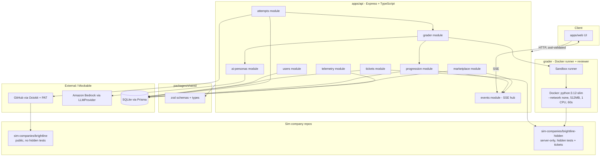
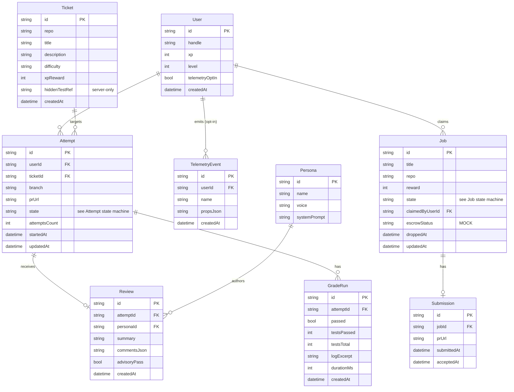
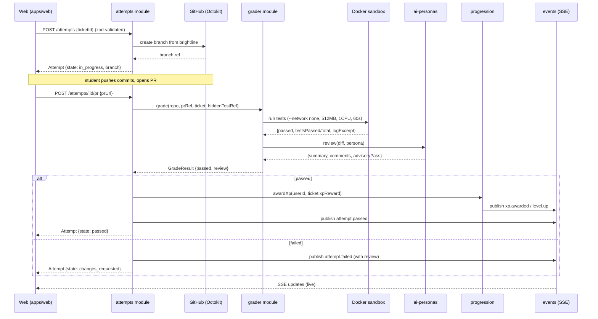
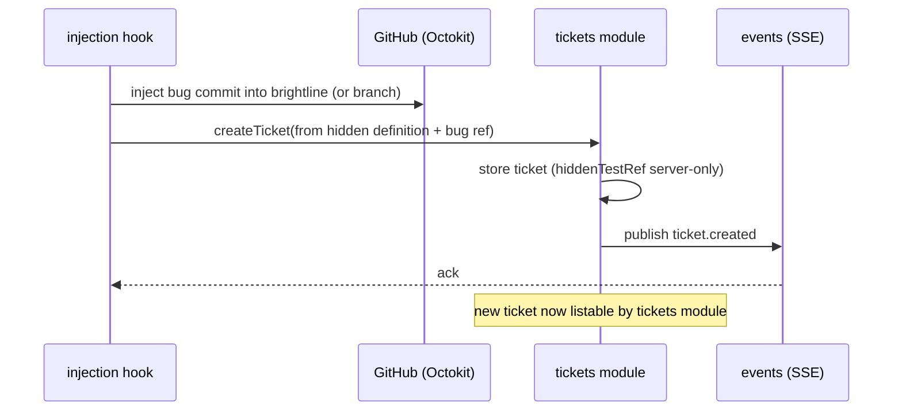
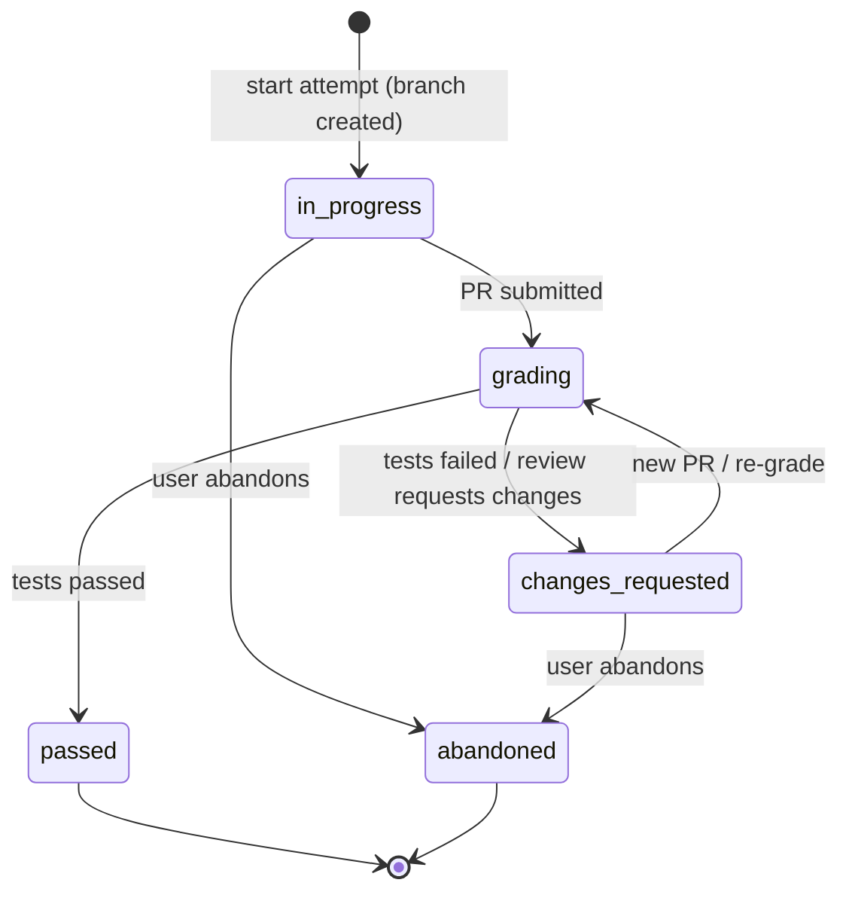
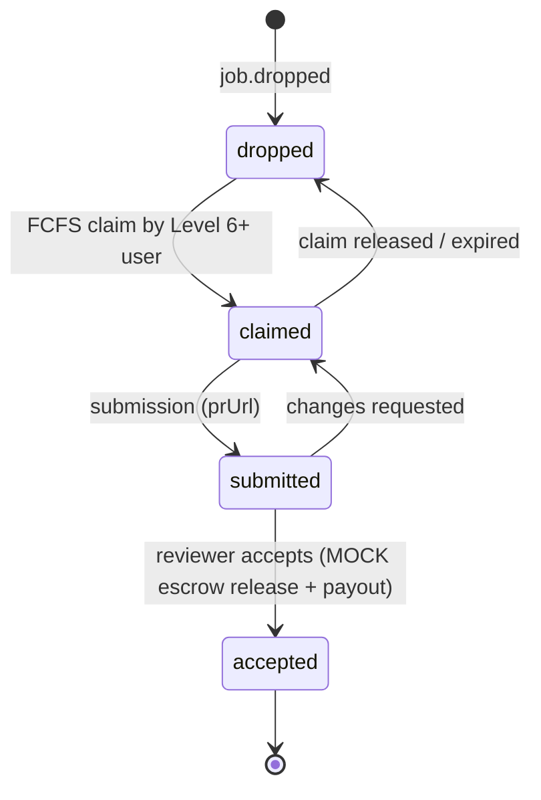

# Design Document: system-architecture

> **Canonical reference.** This document is the authoritative architecture for the
> SideQuest backend and sandbox system. Its sole deliverable is a single planning
> artifact — `/docs/architecture.md` — and it produces **no application code**.
> Every later feature spec (`api-contract`, `sandbox-brightline`, `grader`,
> `core-api`, `marketplace`, `injection-hook`) MUST conform to the module
> boundaries, data model, interfaces, state machines, security model, and build
> plan defined here. If a later spec needs to deviate, this document is updated
> first and the change ripples outward.

## Overview

SideQuest prepares CS students for real engineering work by having them complete
tickets inside simulated company codebases using the real workflow: branch → PR →
hidden tests → AI code review → fix → pass → XP. At Level 6 students unlock a paid,
first-come-first-serve job marketplace. This spec designs the complete backend and
sandbox system that makes that loop work, as a clean monorepo that can scale past
the 8-hour hackathon build.

The system is an Express + TypeScript API (Node 20) organized into feature modules,
backed by Prisma over SQLite (Postgres later), with all input validated by zod and
all errors returned as `{ error: { code, message } }`. Student code is graded by a
Docker sandbox (`python:3.12-slim`, `--network none`, 512 MB memory, 1 CPU, 60 s
timeout) behind a stable grader interface. AI code review and persona generation go
through Amazon Bedrock behind a single `LLMProvider` interface. GitHub integration
uses Octokit with a personal access token from the environment. Auth, Stripe escrow,
and payouts are mocked and clearly labeled with `// MOCK` comments, each with a
documented production replacement path.

The design is split into a **high-level view** (component diagram, module boundaries,
ER diagram, sequence diagrams, state machines, security model, mocks, build plan,
risks) and a **low-level view** (core interfaces, key service function signatures
with formal specifications, and example usage). Both views are written so that the
`/docs/architecture.md` artifact can be produced directly from them, section for
section.

---

## Target Artifact: `/docs/architecture.md`

The planning artifact produced from this design MUST contain exactly these nine
sections, in order. Each maps to a section below.

| # | `/docs/architecture.md` section | Source section in this design |
|---|---------------------------------|-------------------------------|
| 1 | System overview + component diagram | Architecture |
| 2 | Module boundaries and responsibilities | Components and Interfaces |
| 3 | Data model (ER diagram) | Data Models |
| 4 | Sequence diagrams (a/b/c) | Sequence Diagrams |
| 5 | State machines (Attempt, Job) | State Machines |
| 6 | Security model | Security Model (under Security Considerations) |
| 7 | Mocks and production replacements | Mocks and Production Replacement |
| 8 | Build plan (dependency-ordered specs) | Build Plan |
| 9 | Known risks and fallbacks | Known Risks and Fallbacks |

---

## Architecture

**(Artifact section 1: System overview + component diagram.)**

SideQuest runs as a single Express API process with feature modules under
`src/modules/<name>/`. The API is the only component that talks to the database,
the grader, GitHub, and Bedrock. The grader is a separate concern (`/grader`) that
spawns a disposable Docker sandbox per attempt. A Server-Sent Events (SSE) stream
pushes live progress (grade status, review results, XP, job drops) to the web UI.



**Key architectural decisions**

- **Thin routes, fat services.** Every module has `routes.ts` (HTTP + zod parsing
  only), `service.ts` (all business logic), and `schema.ts` (zod schemas re-exported
  from `packages/shared` where shared with the web client).
- **Single DB owner.** Only `apps/api` touches Prisma/SQLite. The grader never
  reads or writes the database directly; it receives inputs and returns results
  through the grader module.
- **Grader behind an interface.** The grader module depends on a `GraderRunner`
  interface, not on Docker directly. This lets a subprocess fallback runner be
  swapped in (see Known Risks).
- **One LLM seam.** All Bedrock calls go through `LLMProvider`, so prompts, retries,
  and model choice are centralized and the provider is mockable.
- **Events as a hub.** The `events` module owns the SSE connection registry; other
  modules publish domain events to it rather than holding socket references.

---

## Components and Interfaces

**(Artifact section 2: Module boundaries and responsibilities.)**

All modules live under `apps/api/src/modules/<name>/` with `routes.ts`,
`service.ts`, and `schema.ts`. Shared zod schemas and types live in
`packages/shared`.

### users
- **Owns:** user records, level/XP read model surface, demo auth resolution.
- **Responsibilities:** resolve the current user from the `X-Demo-User` header
  (`// MOCK`), expose profile and current level/XP, enforce the Level 6 gate check
  used by `marketplace`.
- **Does not:** compute XP (that is `progression`), grade, or touch GitHub.

### tickets
- **Owns:** ticket definitions sourced from `sim-companies/brightline-hidden`.
- **Responsibilities:** list available tickets for a user, expose public ticket
  metadata (title, description, repo, difficulty, XP reward), keep hidden-test
  references server-side only.
- **Does not:** expose hidden tests; never serialize hidden-test paths or contents
  to the client.

### attempts
- **Owns:** the attempt lifecycle (one student's work on one ticket).
- **Responsibilities:** start an attempt (create branch via GitHub), record PR
  linkage, trigger grading, hold attempt state (see State Machines), coordinate
  review and XP award on pass.
- **Does not:** run the sandbox itself (delegates to `grader`), compute XP
  (delegates to `progression`).

### ai-personas
- **Owns:** AI reviewer personas and the review prompt contract.
- **Responsibilities:** generate a code review for a diff using `LLMProvider`
  (Bedrock), in the voice of a configured persona; return structured review
  comments and a pass/fail-advisory signal.
- **Does not:** decide pass/fail on hidden tests (that is grader/attempts), award XP.

### progression
- **Owns:** XP math, levels, and the Level 6 unlock.
- **Responsibilities:** apply XP on a passing attempt, compute level from XP,
  publish `level.up` and `xp.awarded` events, answer "is this user Level 6+?".
- **Does not:** read the `X-Demo-User` header or grade.

### telemetry
- **Owns:** opt-in event capture.
- **Responsibilities:** record anonymized product events **only when the user has
  opted in**; expose opt-in/opt-out toggle; never block the main flow.
- **Does not:** capture anything for users who have not opted in; store PII.

### grader
- **Owns:** the bridge between the API and the sandbox runner + reviewer.
- **Responsibilities:** accept a grade request (repo, ref, ticket, hidden-test
  reference), run student code in the Docker sandbox with enforced limits, collect
  results, invoke `ai-personas` for review, return a `GradeResult`.
- **Does not:** write to the DB; mutate attempt or progression state (returns data
  that `attempts` persists).

### marketplace
- **Owns:** job drops, claims, submissions, acceptance, and mock escrow.
- **Responsibilities:** drop jobs (first-come-first-serve), gate claiming behind
  Level 6 (via `users`/`progression`), accept submissions, release mock escrow and
  trigger mock payout; publish `job.*` events.
- **Does not:** implement real payments (Stripe escrow and payouts are `// MOCK`).

### events
- **Owns:** the SSE hub.
- **Responsibilities:** maintain per-user SSE connections, accept published domain
  events from other modules, fan them out to the right subscribers.
- **Does not:** contain business logic; it is a transport.

**Dependency direction (no cycles):**
`events` is a leaf transport. `progression`, `marketplace`, `grader`, `attempts`
publish to `events`. `attempts → grader → ai-personas`. `attempts → progression`.
`marketplace → users/progression` (Level 6 gate). `users` is foundational. `tickets`
is foundational and read-mostly. `telemetry` is independent and side-channel.

---

## Data Models

**(Artifact section 3: The complete data model as an entity-relationship diagram.)**



**Notes**
- `Ticket.hiddenTestRef` points into `sim-companies/brightline-hidden` and is
  **never** serialized to clients.
- `Job.escrowStatus` and payout are mock fields; see Mocks section.
- Prisma + SQLite now; the schema is Postgres-compatible for later migration.

---

## Sequence Diagrams

**(Artifact section 4: Sequence diagrams.)**

### (a) Start ticket → PR → grade → review → XP



### (b) Job drop → claim → submit → accept → mock escrow release

```mermaid
sequenceDiagram
    participant W as Web
    participant M as marketplace module
    participant U as users/progression
    participant E as events (SSE)

    M->>E: publish job.dropped
    E-->>W: SSE job.dropped
    W->>M: POST /jobs/:id/claim (zod-validated)
    M->>U: isLevel6OrAbove(userId)?
    U-->>M: true
    M->>M: FCFS claim (first wins; others get 409)
    M->>E: publish job.claimed
    M-->>W: Job {state: claimed}

    W->>M: POST /jobs/:id/submit {prUrl}
    M-->>W: Job {state: submitted}

    W->>M: POST /jobs/:id/accept
    M->>M: // MOCK release escrow
    M->>M: // MOCK trigger payout
    M->>E: publish job.accepted / escrow.released
    M-->>W: Job {state: accepted, escrowStatus: released}
```

### (c) Bug-injection hook → new ticket



---

## State Machines

**(Artifact section 5: State machines for Attempt and Job.)**

### Attempt



### Job



---

## Security Considerations

**(Artifact section 6: Security model.)**

**Hidden-test isolation**
- Hidden tests and ticket definitions live only in `sim-companies/brightline-hidden`
  and are server-only. The public `sim-companies/brightline` template contains no
  hidden tests.
- `Ticket.hiddenTestRef` is never serialized to clients; the `tickets` module
  exposes only public metadata. zod response schemas in `packages/shared` omit
  hidden fields so leakage fails type-check.
- The sandbox mounts hidden tests read-only and the student branch separately;
  results returned to the student are limited to pass/fail counts and a bounded log
  excerpt, never raw hidden-test source.

**Sandbox limits (enforced by the grader runner)**
- Image: `python:3.12-slim`.
- `--network none` — no network access from student code.
- `--memory=512m` — 512 MB memory cap.
- `--cpus=1` — 1 CPU.
- 60 s wall-clock timeout; the runner kills and reaps the container on timeout.
- Containers are disposable (one per grade run), non-root where possible, read-only
  root filesystem except an explicit scratch dir.

**Secrets handling**
- GitHub PAT and Bedrock credentials are read from environment variables only;
  never committed, never logged, never returned in responses.
- The grader runs with `--network none`, so student code cannot exfiltrate secrets;
  secrets live only in the API process environment, not in the sandbox.
- Error responses use `{ error: { code, message } }` with no secret material.

**Opt-in telemetry**
- `telemetry` records events only when `User.telemetryOptIn` is true.
- Opt-in is off by default; a toggle endpoint flips it. No PII is stored; event
  props are bounded and anonymized.

---

## Mocks and Production Replacement

**(Artifact section 7: Every mock and how each is replaced in production.)**

Every mock is marked in source with a `// MOCK` comment.

| Mock | How it works today | Production replacement |
|------|--------------------|------------------------|
| **Auth (`X-Demo-User` header)** | `users` resolves the current user from the `X-Demo-User` request header. `// MOCK` | Replace with a real auth middleware (session/JWT/OAuth). Keep the same "resolve current user" seam in `users.service` so routes are unchanged. |
| **Stripe escrow** | `marketplace` sets `Job.escrowStatus` locally; `accept` flips it to `released`. `// MOCK` | Integrate Stripe Connect escrow behind a `PaymentProvider` interface; `marketplace.service` calls the interface instead of mutating the field directly. |
| **Payouts** | `accept` logs a mock payout. `// MOCK` | Call the real payout provider through the same `PaymentProvider` interface; wire webhooks for payout confirmation and update `Job`. |

**Convention:** all mock code paths carry a `// MOCK` comment at the call site so
they are greppable and obvious during the demo and the later swap.

---

## Build Plan

**(Artifact section 8: Feature specs in dependency order.)**

Eight-hour hackathon build, four people (A/B/C/D). Specs in dependency order; each
later spec conforms to this architecture document.

| Order | Spec | Inputs | Outputs | Depends on | Owner | Est. |
|-------|------|--------|---------|------------|-------|------|
| 1 | **api-contract** | This architecture doc; steering files | zod schemas + TS types in `packages/shared`; endpoint contract; error shape | — | A | 1.0 h |
| 2 | **sandbox-brightline** | Steering (Docker limits); structure layout | `sim-companies/brightline` (public template) + `brightline-hidden` (tickets + hidden tests); grader I/O contract | api-contract | B | 1.5 h |
| 3 | **grader** | Grader I/O contract; sandbox repos | `GraderRunner` (Docker) + reviewer via `ai-personas`/`LLMProvider`; `GradeResult` | api-contract, sandbox-brightline | B | 2.0 h |
| 4 | **core-api** | Contract; grader; data model | `users`, `tickets`, `attempts`, `ai-personas`, `progression`, `telemetry`, `events` modules; Prisma schema + SQLite | api-contract, grader | A + C | 2.5 h |
| 5 | **marketplace** | Contract; core-api (Level 6 gate, events) | `marketplace` module; job/claim/submit/accept; `// MOCK` escrow + payout | core-api | C | 1.5 h |
| 6 | **injection-hook** | Contract; tickets module; GitHub | Bug-injection hook that creates new tickets and publishes `ticket.created` | core-api, sandbox-brightline | D | 1.0 h |

Person D also owns `apps/web` integration against the contract in parallel once
`api-contract` lands.

---

## Known Risks and Fallbacks

**(Artifact section 9: Known risks and fallbacks.)**

| Risk | Impact | Fallback |
|------|--------|----------|
| **Docker unavailable on demo machine** | Grader can't run | `GraderRunner` is an interface. Ship a `SubprocessRunner` fallback that runs student code in a local subprocess with the same memory/CPU/timeout caps (best-effort) behind the identical grader interface. Selected by env flag. |
| **Bedrock latency/outage** | AI review stalls | `LLMProvider` returns a canned-but-labeled fallback review; grading pass/fail is independent of review so XP still flows. |
| **GitHub rate limits / PAT issues** | Branch/PR flow breaks | Cache branch/PR calls; allow a manual `prUrl` paste path so the attempt can still be graded from a ref. |
| **SQLite write contention under demo load** | Slow writes | Keep write paths short; batch telemetry; schema already Postgres-compatible for a fast swap. |
| **Hidden-test leakage** | Integrity loss | Response zod schemas omit hidden fields; sandbox returns only bounded results; server-only repo. |
| **FCFS claim race** | Double-claim a job | Claim is a single conditional DB update; losers get `409` with `{ error: { code, message } }`. |
| **Time overrun (8h)** | Incomplete demo | Build in dependency order; marketplace and injection-hook are last and independently cuttable while the core loop still demos end to end. |

---

## Low-Level Design

The following interfaces and function signatures are the contract that `core-api`,
`grader`, `marketplace`, and `injection-hook` implement. TypeScript is used because
the stack is explicitly Node 20 + Express + TypeScript. Services hold the logic;
routes only parse (zod) and call services.

### Core Interfaces and Types

```typescript
// packages/shared — shared contract types (zod-derived)

type ApiError = { error: { code: string; message: string } };

type AttemptState =
  | "in_progress"
  | "grading"
  | "changes_requested"
  | "passed"
  | "abandoned";

type JobState = "dropped" | "claimed" | "submitted" | "accepted";

interface GradeRequest {
  attemptId: string;
  repo: string;
  ref: string;            // branch or PR head
  ticketId: string;
  hiddenTestRef: string;  // server-only; never leaves the API process
}

interface GradeResult {
  passed: boolean;
  testsPassed: number;
  testsTotal: number;
  logExcerpt: string;     // bounded; no hidden-test source
  durationMs: number;
  review: ReviewResult;
}

interface ReviewResult {
  personaId: string;
  summary: string;
  comments: Array<{ path: string; line?: number; body: string }>;
  advisoryPass: boolean;  // advisory only; does not decide XP
}
```

### Key Service Interfaces

```typescript
// grader module depends on this, NOT on Docker directly
interface GraderRunner {
  run(req: GradeRequest): Promise<GradeResult>;
}
// Implementations: DockerRunner (default) and SubprocessRunner (fallback). // MOCK-free

// one seam for all Bedrock calls
interface LLMProvider {
  complete(input: { system: string; prompt: string }): Promise<string>;
}

// GitHub seam
interface GitHubClient {
  createBranch(repo: string, base: string, name: string): Promise<string>;
  getRef(prUrl: string): Promise<{ repo: string; ref: string }>;
}

// payment seam (today both paths are // MOCK)
interface PaymentProvider {
  releaseEscrow(jobId: string): Promise<void>; // MOCK
  payout(jobId: string): Promise<void>;        // MOCK
}
```

### Key Functions with Formal Specifications

#### `attempts.service.startAttempt(userId, ticketId)`

```typescript
function startAttempt(userId: string, ticketId: string): Promise<Attempt>
```
- **Preconditions:** `userId` resolves to an existing user; `ticketId` resolves to a
  listable ticket.
- **Postconditions:** returns an `Attempt` with `state === "in_progress"` and a
  created GitHub branch; no XP awarded; no hidden-test data in the result.
- **Loop invariants:** N/A.

#### `grader.service.grade(req)`

```typescript
function grade(req: GradeRequest): Promise<GradeResult>
```
- **Preconditions:** `req.hiddenTestRef` is a valid server-only reference; sandbox
  limits are configured (`--network none`, 512 MB, 1 CPU, 60 s).
- **Postconditions:** returns a `GradeResult`; `logExcerpt` contains no hidden-test
  source; the sandbox container is destroyed; no DB writes performed.
- **Loop invariants:** while polling the container, elapsed time < 60 s or the
  container is killed and `passed === false` with a timeout log excerpt.

#### `progression.service.awardXp(userId, amount)`

```typescript
function awardXp(userId: string, amount: number): Promise<{ xp: number; level: number }>
```
- **Preconditions:** `amount > 0`; called only after a passing attempt.
- **Postconditions:** `xp` increases by `amount`; `level` is recomputed
  monotonically (never decreases); publishes `xp.awarded`, and `level.up` iff level
  increased.
- **Loop invariants:** N/A.

#### `marketplace.service.claimJob(userId, jobId)`

```typescript
function claimJob(userId: string, jobId: string): Promise<Job>
```
- **Preconditions:** user is Level 6+; job is in `dropped`.
- **Postconditions:** on success, exactly one user transitions the job to `claimed`;
  concurrent losers receive an `ApiError` with code `job_already_claimed` (HTTP 409);
  no escrow movement yet.
- **Loop invariants:** N/A (single conditional update, not a loop).

### Example Usage

```typescript
// attempts/routes.ts — thin route: parse with zod, delegate to service
router.post("/attempts", async (req, res) => {
  const body = StartAttemptSchema.parse(req.body);        // zod
  const userId = resolveDemoUser(req);                    // // MOCK: X-Demo-User
  const attempt = await attempts.startAttempt(userId, body.ticketId);
  res.json(attempt);
});

// grader/service.ts — pick runner behind the interface (Docker or fallback)
const runner: GraderRunner =
  process.env.GRADER_RUNNER === "subprocess"
    ? new SubprocessRunner()     // fallback if Docker is unavailable
    : new DockerRunner();        // default: python:3.12-slim sandbox

const result = await runner.run(gradeRequest);

// marketplace/service.ts — mock escrow release on accept
async function acceptJob(jobId: string) {
  const job = await transitionTo(jobId, "accepted");
  await payments.releaseEscrow(jobId); // MOCK
  await payments.payout(jobId);        // MOCK
  events.publish("job.accepted", { jobId });
  return job;
}
```

## Correctness Properties

*A property is a characteristic or behavior that should hold true across all valid
executions of a system — essentially, a formal statement about what the system should
do. Properties serve as the bridge between human-readable specifications and
machine-verifiable correctness guarantees.*

> **Scope note.** This spec's sole deliverable is the planning artifact
> `/docs/architecture.md`; it produces no application code. The properties below are
> behavioral properties of the **future runtime system** that this architecture
> describes, and they are implemented and tested by the downstream specs
> (`core-api`, `grader`, `marketplace`). They are retained here for traceability and
> are mapped to the requirements in this spec that mandate the corresponding behavior
> be captured in the Architecture_Document.

### Property 1: Hidden-test confidentiality
For every API response, no field derives from `hiddenTestRef` contents or
hidden-test source.

**Validates: Requirements 4.3, 7.1**

### Property 2: Sandbox containment
Every grade run executes with `--network none`, ≤ 512 MB memory, ≤ 1 CPU, and
terminates within 60 seconds.

**Validates: Requirements 7.2**

### Property 3: XP monotonicity
A user's level never decreases across any sequence of `awardXp` calls.

**Validates: Requirements 3.1, 3.2, 6.3**

### Property 4: Level 6 gate
`claimJob` succeeds only if the user is Level 6 or above.

**Validates: Requirements 3.2, 6.4**

### Property 5: FCFS single claim
At most one user can move a given job from `dropped` to `claimed`.

**Validates: Requirements 5.2, 6.4**

### Property 6: Mock labeling
Every escrow, payout, and auth mock call site carries a `// MOCK` comment.

**Validates: Requirements 8.3**

### Property 7: Error shape
Every error response matches `{ error: { code, message } }`.

**Validates: Requirements 3.2, 8.2**

---

## Error Handling

All errors are returned in the steering-mandated shape `{ error: { code, message } }`
with an appropriate HTTP status. No secret material appears in any error.

| Scenario | Condition | Response | Recovery |
|----------|-----------|----------|----------|
| Invalid request body | zod parse fails in `routes.ts` | `400 { error: { code: "validation_error", message } }` | Client fixes payload and retries. |
| Unknown user/ticket | Lookup misses | `404 { error: { code: "not_found", message } }` | Client refreshes list. |
| Job already claimed | FCFS loser | `409 { error: { code: "job_already_claimed", message } }` | Client picks another job (SSE shows live state). |
| Below Level 6 on claim | Level gate fails | `403 { error: { code: "level_gate", message } }` | User completes more tickets. |
| Sandbox timeout | Grade exceeds 60 s | `GradeResult{ passed:false }` with timeout log excerpt; attempt → `changes_requested` | Student optimizes and re-submits. |
| Docker unavailable | Runner init fails | Fall back to `SubprocessRunner` behind the same interface | Grading continues degraded. |
| Bedrock error | `LLMProvider` throws/timeouts | Labeled fallback review; grading pass/fail unaffected | Review retried later; XP still flows. |
| GitHub failure | Octokit error | `502 { error: { code: "github_error", message } }`; allow manual `prUrl` path | Retry or paste PR URL. |

## Testing Strategy

### Unit testing
- Service-level tests for `startAttempt`, `grade`, `awardXp`, `claimJob`, and the
  Level 6 gate, with the `GraderRunner`, `LLMProvider`, `GitHubClient`, and
  `PaymentProvider` interfaces mocked.
- zod schema tests asserting hidden fields (e.g., `hiddenTestRef`) never appear in
  response schemas.

### Property-based testing
- **Library:** fast-check (TypeScript).
- Candidate properties: P3 (XP monotonicity across random `awardXp` sequences),
  P5 (FCFS single-claim under concurrent claims), P7 (error shape invariant across
  randomized failing inputs).

### Integration testing
- End-to-end happy path for the core loop (start → PR → grade → review → XP) against
  the `SubprocessRunner` so it runs without Docker in CI.
- Marketplace flow (drop → claim → submit → accept → mock escrow release) asserting
  `// MOCK` escrow/payout are exercised and labeled.

---

## Dependencies

- Runtime: Node 20, Express, TypeScript.
- Data: Prisma + SQLite (Postgres-compatible schema for later).
- Validation: zod (schemas shared via `packages/shared`).
- Sandbox: Docker with `python:3.12-slim`.
- LLM: Amazon Bedrock behind `LLMProvider`.
- GitHub: Octokit with a PAT from env.
- Transport: Server-Sent Events for live updates.
