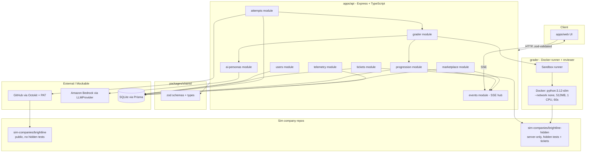
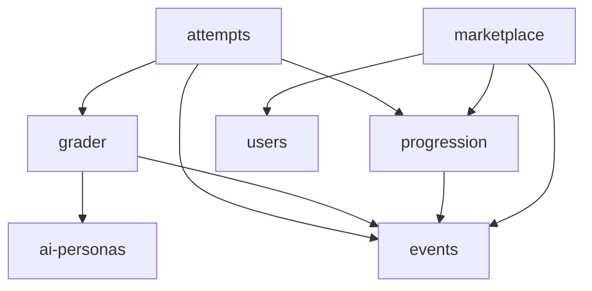
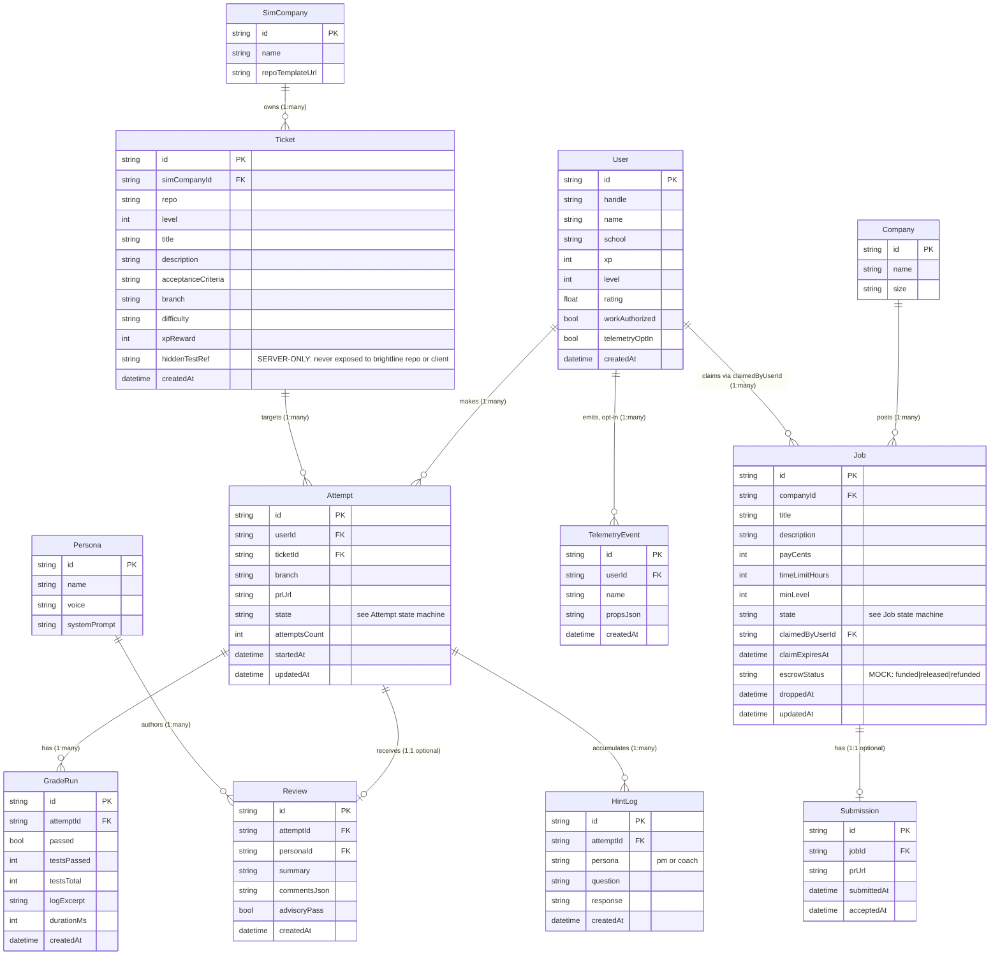
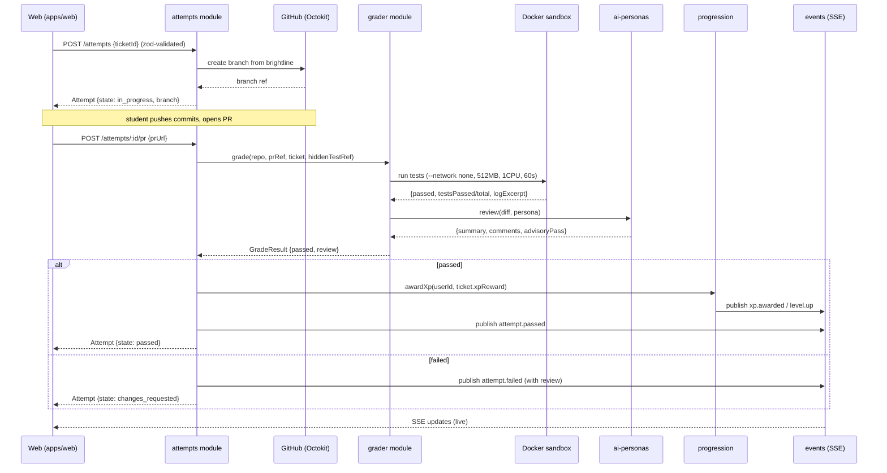
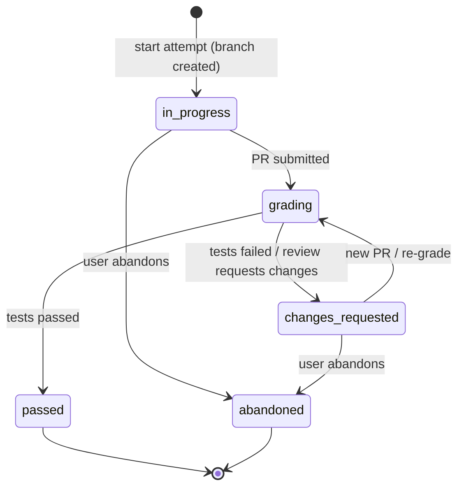
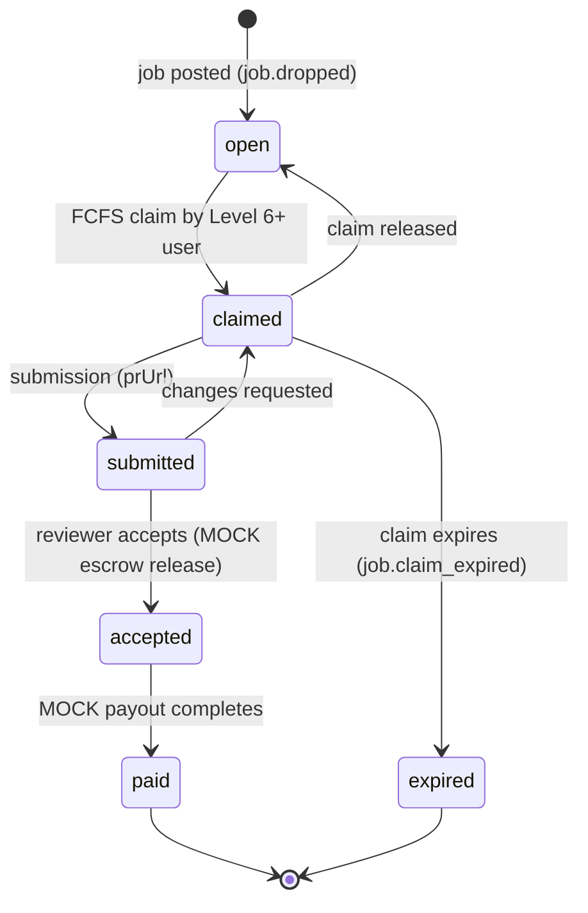

# SideQuest Backend & Sandbox Architecture

> **Authoritative reference.** This document is the authoritative reference for the
> SideQuest backend and sandbox system. It is the single canonical source of truth
> for the system's module boundaries, data model, interfaces, state machines,
> security model, and build plan.

## About this document

Every later feature spec — `api-contract`, `sandbox-brightline`, `grader`,
`core-api`, `marketplace`, and `injection-hook` — **must conform** to each of the
following elements as defined in this document:

- **Module boundaries** — which module owns which responsibility.
- **Data model** — the entities, their attributes, and their relationships.
- **Interfaces** — the service and provider contracts between components.
- **State machines** — the valid states and transitions for each entity.
- **Security model** — hidden-test isolation, sandbox limits, secrets, telemetry.
- **Build plan** — the dependency-ordered sequence of specs and their ownership.

### Conflict and deviation rule

If a later spec conflicts with any element defined in this document, **this
document is updated first** — before the later spec is approved. A later spec is
never approved while it contradicts an element defined here; the architecture is
reconciled first and the change ripples outward to the later spec.

Where a deviation has been approved, the updated document **must identify the
superseded element and the date the change took effect**, so every change to the
authoritative architecture is traceable to the element it replaced and when it
became effective.

### Change log (approved deviations)

Every row records a superseded element, the element that replaces it, and the date
the change took effect, per the conflict-and-deviation rule above.

| Date | Superseded element | Replaced by | Driven by |
|------|--------------------|-------------|-----------|
| 2026-10-24 | §3 data model: nine entities (`User`, `Ticket`, `Attempt`, `GradeRun`, `Review`, `Persona`, `Job`, `Submission`, `TelemetryEvent`) | §3 now adds `Company`, `SimCompany`, and `HintLog` as entities (twelve total); escrow remains a `Job` field, and no `Claim`/`EscrowTransaction` entity is introduced | `api-contract` (C3) |
| 2026-10-24 | §3 `User` attributes `handle`, `xp`, `level`, `telemetryOptIn`, `createdAt` | §3 `User` now carries `id`, `handle`, `name`, `school`, `xp`, `level`, `rating`, `workAuthorized`, `telemetryOptIn`, `createdAt`; `telemetryOptIn` remains the opt-in field name (not `optInProfile`) | `api-contract` (C4) |
| 2026-10-24 | §3 `Ticket` had no sim-company linkage; §3 had no `Company`/`SimCompany` | `Ticket` gains `simCompanyId` (FK to `SimCompany`); `SimCompany` owns `repoTemplateUrl`; `Company` owns job postings | `api-contract` (C3) |
| 2026-10-24 | §5 Job state machine states `dropped`, `claimed`, `submitted`, `accepted` | §5 Job states are now `open`, `claimed`, `submitted`, `accepted`, `paid`, `expired`; `open` is the initial (formerly `dropped`) state, `paid` follows `accepted` on mock payout, and `expired` is reachable from `claimed` on claim timeout. `Job.escrowStatus` (`funded`/`released`/`refunded`, `// MOCK`), `Job.claimedByUserId`, and `Job.claimExpiresAt` carry claim and escrow state; no separate `Claim` or `EscrowTransaction` entity exists | `api-contract` (C2, C6) |
| 2026-10-24 | §4b / §5 marketplace events `job.dropped`, `job.claimed`, `job.accepted`, `escrow.released` | Marketplace SSE events are `job.dropped`, `job.claimed`, and `job.claim_expired` for the live stream; `job.accepted` / `escrow.released` remain internal publish points. Claim expiry (`job.claim_expired`) maps to the Job `claimed --> open` transition | `api-contract` (C6) |

**Unchanged by this reconciliation.** The Attempt state machine (§5:
`in_progress → grading → passed/changes_requested → abandoned`) is retained as-is;
`api-contract` conforms to it (C1 resolved in favor of the architecture). AI
personas `pm` and `coach` are named `Persona` instances and introduce no model
change (C5).

### Scope

This spec is **planning and documentation only**. It produces **only this
document** — `/docs/architecture.md` — and **no application code, configuration
files, or executable application scripts**. All runtime behavior described here is
implemented and verified by the downstream feature specs listed above.

## 1. System Overview

SideQuest runs as a single **Express + TypeScript API** process (Node 20) whose
feature modules live under `src/modules/<name>/`; the API is the only component
that talks to the database, the grader, GitHub, and Bedrock, with thin routes
parsing zod-validated input and fat services holding the business logic. The
**grader** is a separate concern that spawns a disposable Docker sandbox
(`python:3.12-slim`, `--network none`, 512 MB memory, 1 CPU, 60 s timeout) per
attempt to run student code behind a stable grader interface, and never reads or
writes the database directly. A **Server-Sent Events (SSE)** transport, owned by
the `events` module, pushes live progress — grade status, review results, XP, and
job drops — from the API out to the web UI.

The component diagram below shows the full system. The API feature modules are the
only component with a read/write connection to SQLite; the grader, Docker sandbox,
GitHub, and Bedrock are all reached through (or feed back into) the API, and the
SSE hub fans domain events out to the client.



## 2. Module Boundaries and Responsibilities

All modules live under `apps/api/src/modules/<name>/`, each with a thin `routes.ts`
(HTTP + zod parsing), a fat `service.ts` (all business logic), and a `schema.ts`
(zod schemas, re-exported from `packages/shared` where shared with the web client).
Shared zod schemas and types live in `packages/shared`.

The nine modules below have disjoint ownership: each responsibility is owned by
exactly one module, and every module's "does not own" clause defers the adjacent
responsibility to the module that does own it. No responsibility appears as owned
by two modules.

### users

- **Owns:** user records; the level/XP read-model surface (profile and current
  level/XP); demo auth resolution from the `X-Demo-User` request header (`// MOCK`);
  the Level 6 gate check consumed by `marketplace`.
- **Does not own:** computing XP (owned by `progression`); grading (owned by
  `grader`); any GitHub interaction (owned by `attempts`).

### tickets

- **Owns:** ticket definitions sourced from `sim-companies/brightline-hidden`;
  listing available tickets for a user; exposing public ticket metadata (title,
  description, repo, difficulty, XP reward); keeping hidden-test references
  server-side only.
- **Does not own:** exposing hidden tests (never serializes hidden-test paths or
  contents to the client); grading; XP math.

### attempts

- **Owns:** the attempt lifecycle — one student's work on one ticket; starting an
  attempt (branch creation via GitHub); recording PR linkage; triggering grading;
  holding attempt state (per the Attempt state machine); coordinating review and the
  XP award on a pass.
- **Does not own:** running the sandbox (delegates to `grader`); computing XP
  (delegates to `progression`).

### ai-personas

- **Owns:** AI reviewer personas and the review-prompt contract; generating a code
  review for a diff via `LLMProvider` (Bedrock) in the voice of a configured
  persona; returning structured review comments and a pass/fail **advisory** signal.
- **Does not own:** deciding pass/fail on hidden tests (owned by `grader`/`attempts`);
  awarding XP (owned by `progression`).

### progression

- **Owns:** XP math, level computation, and the Level 6 unlock; applying XP on a
  passing attempt; computing level from XP; publishing `xp.awarded` and `level.up`
  events; answering "is this user Level 6+?".
- **Does not own:** reading the `X-Demo-User` header (owned by `users`); grading
  (owned by `grader`).

### telemetry

- **Owns:** opt-in event capture; recording anonymized product events **only when
  the user has opted in**; exposing the opt-in/opt-out toggle.
- **Does not own:** capturing anything for users who have not opted in; storing PII;
  blocking the main flow (it is a side channel).

### grader

- **Owns:** the bridge between the API and the sandbox runner and reviewer;
  accepting a grade request (repo, ref, ticket, hidden-test reference); running
  student code in the Docker sandbox with enforced limits; collecting results;
  invoking `ai-personas` for review; returning a `GradeResult`.
- **Does not own:** writing to the database; mutating attempt or progression state
  (it returns data that `attempts` persists).

### marketplace

- **Owns:** job drops, claims, submissions, acceptance, and mock escrow; dropping
  jobs first-come-first-serve; gating claims behind Level 6 (via `users`/
  `progression`); accepting submissions; releasing mock escrow and triggering mock
  payout; publishing `job.*` events.
- **Does not own:** real payments (Stripe escrow and payouts are `// MOCK`);
  computing the level used by its own gate (reads it from `users`/`progression`).

### events

- **Owns:** the SSE hub; maintaining per-user SSE connections; accepting published
  domain events from other modules; fanning them out to the right subscribers.
- **Does not own:** any business logic — it is a transport only.

### Inter-module dependency direction (acyclic)

The dependency graph is a directed acyclic graph (DAG) with no cyclic path. Edges
point from a module to a module it depends on:



Dependency direction, module by module:

- **attempts** depends on `grader` (delegates sandbox runs), `progression`
  (delegates XP), and `events` (publishes attempt updates).
- **grader** depends on `ai-personas` (invokes review) and `events`.
- **marketplace** depends on `users` and `progression` (the Level 6 gate) and
  `events`.
- **progression** depends on `events` (publishes `xp.awarded` / `level.up`).
- **ai-personas** depends on no other module. It has **no outgoing module
  dependencies** (its only external call is to the `LLMProvider`/Bedrock seam, not
  to another module).
- **users** depends on no other module. It has **no outgoing module dependencies**;
  it is foundational and consumed by `marketplace` and `progression`.
- **tickets** depends on no other module. It has **no outgoing module
  dependencies**; it is foundational and read-mostly, sourced from
  `sim-companies/brightline-hidden`.
- **telemetry** depends on no other module. It has **no outgoing module
  dependencies**; it is an independent side channel.
- **events** depends on no other module. It is a leaf transport and has **no
  outgoing module dependencies**; other modules publish to it.

Because every edge points toward a foundational or leaf module (`users`, `tickets`,
`telemetry`, `ai-personas`, and the `events` transport sink), and no module both
depends on and is depended on by the same counterpart, the graph contains no cycle.

## 3. Data Model

The data model below is the complete entity-relationship model for the SideQuest
backend. It targets Prisma over SQLite today and is Postgres-compatible for a later
migration. There are exactly twelve entities — User, Company, SimCompany, Ticket,
Attempt, GradeRun, Review, Persona, HintLog, Job, Submission, and TelemetryEvent —
and no others. Each entity declares at least one primary-key identifier (`id`,
marked `PK`), and every relationship between two entities carries an explicit
cardinality.

> **Superseded 2026-10-24 (see Change log).** This model formerly declared exactly
> nine entities and omitted `Company`, `SimCompany`, and `HintLog`; those three
> were added for `api-contract`. Escrow and claim state remain `Job` fields — no
> `Claim` or `EscrowTransaction` entity is introduced.

**Hidden-test confidentiality.** `Ticket.hiddenTestRef` is a **server-only** field.
It points into `sim-companies/brightline-hidden` and is **never** exposed to the
student-facing `sim-companies/brightline` repository or to any client — zod response
schemas in `packages/shared` omit it so any attempt to leak it fails type-check.
Likewise `Job.escrowStatus` is a mock field (`// MOCK`) carried for the demo escrow
flow, taking the values `funded`, `released`, or `refunded`; escrow is modeled as
this field on `Job` (plus `Job.claimedByUserId` and `Job.claimExpiresAt` for claim
state), not as a separate `Claim` or `EscrowTransaction` entity.

**Relationship cardinalities.**

- `SimCompany` **1:many** `Ticket` — a sim company owns many tickets; each ticket belongs to one sim company (`Ticket.simCompanyId`).
- `Company` **1:many** `Job` — a company posts many jobs; each job belongs to one company.
- `Attempt` **1:many** `HintLog` — an attempt accumulates many hint exchanges; each hint log belongs to one attempt.
- `User` **1:many** `Attempt` — a user makes many attempts; each attempt belongs to one user.
- `User` **1:many** `TelemetryEvent` — a user emits many opt-in telemetry events; each event belongs to one user.
- `User` **1:many** `Job` — a user claims many jobs over time via `Job.claimedByUserId`; each job is claimed by at most one user.
- `Ticket` **1:many** `Attempt` — a ticket is targeted by many attempts; each attempt targets one ticket.
- `Attempt` **1:1 (optional)** `Review` — an attempt receives at most one review; each review belongs to one attempt.
- `Attempt` **1:many** `GradeRun` — an attempt has many grade runs (one per submission); each grade run belongs to one attempt.
- `Persona` **1:many** `Review` — a persona authors many reviews; each review is authored by one persona.
- `Job` **1:1 (optional)** `Submission` — a job has at most one submission; each submission belongs to one job.



**Notes**

- `Ticket.hiddenTestRef` references `sim-companies/brightline-hidden` and is
  **never** serialized to clients or to the public `sim-companies/brightline`
  template; it stays inside the API process.
- `Job.escrowStatus` and the payout flow are mock fields (`// MOCK`); see the Mock
  inventory section.
- Prisma + SQLite is used now; the schema above is Postgres-compatible for a later
  migration.

## 4. Sequence Diagrams

This section traces the system's key runtime flows as Mermaid sequence diagrams.
Every participant is a component named elsewhere in this document, and each diagram
orders its interactions chronologically from top to bottom.

### (a) Start ticket → PR → grade → review → XP

This diagram follows the core learning loop in five ordered steps: (1) the student
**starts a ticket** and `attempts` creates a branch via GitHub; (2) the student
opens a **PR** and `attempts` records it; (3) `attempts` requests a **grade** and
`grader` runs the student code in the Docker sandbox under its enforced limits;
(4) `grader` obtains an advisory **review** from `ai-personas`; and (5) on a pass,
`attempts` triggers the **XP award** in `progression`, with `events` streaming live
updates throughout.



### (b) Job drop → claim → submit → accept → mock escrow release

This diagram follows the marketplace flow in five ordered steps: (1) `marketplace`
**drops a job** and publishes `job.dropped` through `events`; (2) a Level 6+ user
**claims** it first-come-first-serve, with `marketplace` checking the Level 6 gate
via `users`/`progression` and awarding the claim to the first caller (concurrent
losers get `409`); (3) the user **submits** a PR; (4) a reviewer **accepts** the
submission; and (5) on accept, `marketplace` performs the **mock escrow release**
and **mock payout** (`// MOCK`), moving the job `accepted → paid`, and publishes the
internal `job.accepted` / `escrow.released` signals. The three events fanned out on
the live `/events` SSE stream are `job.dropped`, `job.claimed`, and
`job.claim_expired` (see §5 Change log); `job.accepted` / `escrow.released` are
internal publish points consumed server-side.

```mermaid
sequenceDiagram
    participant W as Web (apps/web)
    participant M as marketplace module
    participant U as users/progression
    participant E as events (SSE)

    Note over M,E: 1. Job drop (state: open)
    M->>E: publish job.dropped
    E-->>W: SSE job.dropped

    Note over W,U: 2. Claim (FCFS, Level 6 gated)
    W->>M: POST /jobs/:id/claim (zod-validated)
    M->>U: isLevel6OrAbove(userId)?
    U-->>M: true
    M->>M: FCFS claim (first wins; others get 409 job_already_claimed)
    M->>E: publish job.claimed
    M-->>W: Job {state: claimed, claimedByUserId, claimExpiresAt}

    Note over W,M: 3. Submit
    W->>M: POST /jobs/:id/submit {prUrl}
    M-->>W: Job {state: submitted}

    Note over W,M: 4. Accept
    W->>M: POST /jobs/:id/accept

    Note over M,E: 5. Mock escrow release + payout (accepted -> paid)
    M->>M: // MOCK release escrow (escrowStatus: released)
    M->>M: // MOCK trigger payout
    M->>E: publish job.accepted / escrow.released (internal)
    M-->>W: Job {state: paid, escrowStatus: released}
```

### (c) Bug-injection hook → new ticket

This diagram follows the bug-injection flow in ordered steps from hook trigger to a
new, listable ticket: (1) the **injection hook** fires and injects a bug commit into
the public `sim-companies/brightline` template (or a branch) via **GitHub**; (2) the
hook asks the **tickets** module to create a new ticket from a hidden ticket
definition plus the bug reference; (3) `tickets` stores the ticket, keeping its
`hiddenTestRef` **server-only**; and (4) `tickets` publishes `ticket.created` through
**events**, after which the new ticket is listable by the `tickets` module.

```mermaid
sequenceDiagram
    participant H as injection hook
    participant GH as GitHub (Octokit)
    participant T as tickets module
    participant E as events (SSE)

    Note over H,GH: 1. Inject bug
    H->>GH: inject bug commit into brightline (or branch)
    GH-->>H: commit ref

    Note over H,T: 2. Create ticket from hidden definition + bug ref
    H->>T: createTicket(from hidden definition + bug ref)

    Note over T: 3. Store ticket (hiddenTestRef server-only)
    T->>T: store ticket (hiddenTestRef server-only; never exposed)

    Note over T,E: 4. Publish ticket.created
    T->>E: publish ticket.created
    E-->>H: ack
    Note over T: new ticket now listable by tickets module
```

## 5. State Machines

This section defines the valid states and transitions for the two stateful entities
in the system — the `Attempt` and the `Job`. Each state machine is a Mermaid
`stateDiagram-v2` whose edges are the only permitted transitions, each labeled with
the event that triggers it.

### Attempt

An `Attempt` tracks one student's work on one ticket. It begins in `in_progress`
when the attempt is started (a GitHub branch is created), moves to `grading` when a
PR is submitted, and from `grading` resolves to either `passed` (hidden tests pass)
or `changes_requested` (tests failed or the review requests changes). A
`changes_requested` attempt returns to `grading` when the student submits a new PR
to re-grade. From either `in_progress` or `changes_requested` the student may
abandon the attempt, moving it to `abandoned`. The initial state is `in_progress`;
the terminal states are `passed` and `abandoned`.



**Terminal states.** `passed` and `abandoned` are terminal — once an attempt reaches
either, it has no outgoing transitions and the lifecycle ends. `in_progress`,
`grading`, and `changes_requested` are non-terminal working states.

### Job

> **Superseded 2026-10-24 (see Change log).** The Job state machine formerly used
> states `dropped → claimed → submitted → accepted` with `dropped` as the initial
> state. It now uses `open → claimed → submitted → accepted → paid` with `expired`
> reachable from `claimed`. `open` replaces the former `dropped` initial state; the
> `job.dropped` event name is retained for the publish on entry to `open`.

A `Job` tracks one marketplace job from posting to payout. It begins in `open` when
the job is posted/dropped (publishing `job.dropped`), moves to `claimed` when a
Level 6+ user claims it first-come-first-serve, and to `submitted` when the claimant
submits a PR. From `submitted` a reviewer may **accept** the submission — moving the
job to `accepted` and triggering the mock escrow release — or request changes,
returning the job to `claimed`. An `accepted` job moves to `paid` when the mock
payout completes. A `claimed` job may be released or **expire** when
`claimExpiresAt` passes: a release returns it to `open`, and an expiry moves it to
the terminal `expired` state (publishing `job.claim_expired`). The initial state is
`open`; the terminal states are `paid` and `expired`.



**Terminal states.** `paid` and `expired` are terminal — once a job reaches either
it has no outgoing transitions and the lifecycle ends. `open`, `claimed`,
`submitted`, and `accepted` are non-terminal working states. The mock escrow
(`Job.escrowStatus`) moves `funded → released` across the accept transition and
`funded → refunded` on expiry (`// MOCK`).

## 6. Security Model

The security model governs four concerns: keeping hidden tests and ticket
definitions off the wire, confining student code inside the grader sandbox,
handling third-party credentials safely, and recording telemetry only with the
user's consent. Each is a hard requirement that every downstream spec (`core-api`,
`grader`, `marketplace`, `injection-hook`) must honor.

### Hidden-test isolation

Hidden tests and ticket definitions live only in `sim-companies/brightline-hidden`,
which is **server-only** and never exposed to the client or to the public
`sim-companies/brightline` template (the public template contains no hidden tests).
The `Ticket.hiddenTestRef` field — the reference into the hidden repo — is a
server-only field: it is never serialized to a client, and the zod response schemas
in `packages/shared` omit it so that any accidental leakage fails type-check rather
than reaching a response.

**No API response includes hidden-test or ticket-definition contents.** When a grade
run completes, the data returned to the student is limited to pass/fail counts
(`testsPassed` / `testsTotal`) and a bounded `logExcerpt`; the excerpt is sanitized
so it never contains hidden-test source. The sandbox mounts the hidden tests
read-only and separately from the student branch, so student code can observe test
outcomes but cannot read the raw hidden-test files back out through a response.

### Sandbox limits

The grader runner executes every grade run in a disposable Docker container built
from `python:3.12-slim`, under the following enforced limits:

| Limit | Value | Enforced by |
|-------|-------|-------------|
| Network | `--network none` — no network access from student code | Docker run flag |
| Memory | `--memory=512m` — 512 MB cap | Docker run flag |
| CPU | `--cpus=1` — 1 CPU | Docker run flag |
| Wall-clock | 60-second execution timeout | Runner watchdog |

**Timeout handling.** A run that exceeds the 60-second wall-clock timeout is
**terminated and reported as failed**: the runner kills and reaps the container and
returns a `GradeResult` with `passed: false` and a timeout log excerpt. The
container is disposable (one per grade run), runs non-root where possible, and uses
a read-only root filesystem except for an explicit scratch directory. Because the
sandbox has `--network none`, student code cannot reach the network to exfiltrate
anything, regardless of what it attempts.

### Secrets handling

The GitHub personal access token (used by Octokit) and the Amazon Bedrock
credentials are read **only from environment variables** in the API process. They
are:

- **Never committed** — they exist only in the process environment, not in source.
- **Never logged** — no log line emits a credential value.
- **Never returned in responses** — including error responses, which use the
  `{ error: { code, message } }` shape and carry no secret material.

Because the grader sandbox runs with `--network none` and the secrets live only in
the API process environment (not inside the sandbox), student code has no path to
read them.

**Missing credential at startup.** If the GitHub PAT or the Bedrock credentials are
absent when the system starts, the system surfaces this as an error that identifies
*which* credential is missing **without exposing any credential value** — the error
names the missing environment variable, never prints a partial or full secret, and
follows the `{ error: { code, message } }` shape.

### Opt-in telemetry

Telemetry is consent-gated through the `telemetry` module. Events are **recorded
only when the user has opted in** (`User.telemetryOptIn === true`). When a user has
not opted in (the default) or has explicitly opted out, **no telemetry event is
recorded** for that user. Opt-in is off by default and is flipped by an explicit
toggle endpoint; recorded event props are bounded and anonymized, and no PII is
stored.

## 7. Mocks and Production Replacements

Three capabilities are mocked for the hackathon build so the core loop can demo end
to end without real authentication or real money movement. Each mock is a narrow,
clearly bounded seam with a **defined** production replacement; none is left open.
All three have a documented replacement — none is marked with the explicit
"undefined" indicator reserved for a mock lacking a replacement path.

### MOCK convention

**Every mock code path is marked in source with a `// MOCK` comment** at the call
site, so mocks are greppable and obvious during the demo and the later swap. The
convention also fixes how an unreplaced mock is recorded: **if a listed mock had no
documented production replacement, it would be marked with an explicit "undefined"
indicator** for its replacement. All three mocks below have a defined replacement,
so none carries that indicator.

### Mock inventory

| Mock | Source location (file path) | Containing component/module | Production replacement mechanism | Observable behavior the replacement provides |
|------|-----------------------------|-----------------------------|----------------------------------|----------------------------------------------|
| **`X-Demo-User` auth mock** | `apps/api/src/modules/users/service.ts` (the `resolveDemoUser` seam, marked `// MOCK`) | `users` module | A real **auth middleware** (session/JWT/OAuth) that resolves the current user, substituted behind the same "resolve current user" seam in `users.service` so routes are unchanged. | The current user is resolved from a verified, authenticated session/token instead of a plaintext `X-Demo-User` header; unauthenticated or forged requests are rejected, and every route downstream receives the same resolved-user contract it does today. |
| **Stripe escrow mock** | `apps/api/src/modules/marketplace/service.ts` (the escrow release on accept, marked `// MOCK`) | `marketplace` module | **Stripe Connect escrow** integrated behind a `PaymentProvider` interface; `marketplace.service` calls `PaymentProvider.releaseEscrow(jobId)` instead of mutating `Job.escrowStatus` directly. | Funds are genuinely held and released through Stripe on job acceptance; `Job.escrowStatus` reflects real escrow state driven by the provider (and its webhooks) rather than a locally flipped field. |
| **Payouts mock** | `apps/api/src/modules/marketplace/service.ts` (the payout trigger on accept, marked `// MOCK`) | `marketplace` module | The real **payout provider** called through the same `PaymentProvider` interface (`PaymentProvider.payout(jobId)`), with webhooks wired for payout confirmation to update the `Job`. | A real payout is disbursed to the claimant on acceptance, and the `Job` is updated from a confirmed payout webhook instead of a logged mock payout. |

**Seam preservation.** Each replacement keeps the mock's call-site contract intact:
auth swaps behind the `users.service` resolve-current-user seam, and both escrow and
payout swap behind the single `PaymentProvider` interface — so `marketplace.service`
and the routes that depend on these seams do not change when the mocks are replaced.

## 8. Build Plan

This section sequences the six feature specs in **dependency order** for the
8-hour hackathon build with four people (Person A, Person B, Person C, Person D).
The ordering guarantees that **each spec appears after every spec it depends on**,
so no spec is scheduled before its inputs exist. Every spec below depends only on
other specs within this list of six; **any dependency on a spec outside these six
would be flagged as unresolved — none here are.**

### Dependency-ordered spec list

#### 1. api-contract

- **Inputs:** This architecture document; the steering files (product, tech,
  structure).
- **Outputs:** zod schemas and TypeScript types in `packages/shared`; the endpoint
  contract; the canonical error shape `{ error: { code, message } }`.
- **Dependencies:** none (foundational; first in order).
- **Owner:** Person A.
- **Time estimate:** 1.0 h.

#### 2. sandbox-brightline

- **Inputs:** Steering (Docker sandbox limits); the `structure` repo layout.
- **Outputs:** `sim-companies/brightline` (public student template, no hidden
  tests) and `sim-companies/brightline-hidden` (tickets + hidden tests,
  server-only); the grader I/O contract.
- **Dependencies:** api-contract.
- **Owner:** Person B.
- **Time estimate:** 1.5 h.

#### 3. grader

- **Inputs:** The grader I/O contract; the sandbox repos from sandbox-brightline.
- **Outputs:** `GraderRunner` (Docker implementation) plus the reviewer via
  `ai-personas`/`LLMProvider`; the `GradeResult` type.
- **Dependencies:** api-contract, sandbox-brightline.
- **Owner:** Person B.
- **Time estimate:** 2.0 h.

#### 4. core-api

- **Inputs:** The api-contract; the grader; the data model from this document.
- **Outputs:** the `users`, `tickets`, `attempts`, `ai-personas`, `progression`,
  `telemetry`, and `events` modules; the Prisma schema + SQLite.
- **Dependencies:** api-contract, grader.
- **Owner:** Person A and Person C.
- **Time estimate:** 2.5 h.

#### 5. marketplace

- **Inputs:** The api-contract; core-api (the Level 6 gate and the events hub).
- **Outputs:** the `marketplace` module; job drop/claim/submit/accept; the
  `// MOCK` escrow and payout paths.
- **Dependencies:** core-api.
- **Owner:** Person C.
- **Time estimate:** 1.5 h.

#### 6. injection-hook

- **Inputs:** The api-contract; the `tickets` module; GitHub (Octokit + PAT).
- **Outputs:** the bug-injection hook that creates new tickets and publishes
  `ticket.created`.
- **Dependencies:** core-api, sandbox-brightline.
- **Owner:** Person D.
- **Time estimate:** 1.0 h.

### Dependency-order check

Reading top to bottom, every spec's dependencies already appear above it:
api-contract (none) → sandbox-brightline (needs api-contract) → grader (needs
api-contract, sandbox-brightline) → core-api (needs api-contract, grader) →
marketplace (needs core-api) → injection-hook (needs core-api, sandbox-brightline).
No dependency points to a spec outside the six, so there are **no unresolved
dependencies**.

### Per-owner time check (8-hour hackathon)

core-api is co-owned by Person A and Person C; its 2.5 h is split evenly
(1.25 h each) for the per-owner totals below.

| Owner | Specs owned (hours) | Total | Within 8 h? |
|-------|---------------------|-------|-------------|
| **Person A** | api-contract (1.0) + half of core-api (1.25) | **2.25 h** | Yes |
| **Person B** | sandbox-brightline (1.5) + grader (2.0) | **3.5 h** | Yes |
| **Person C** | half of core-api (1.25) + marketplace (1.5) | **2.75 h** | Yes |
| **Person D** | injection-hook (1.0) + `apps/web` integration | **1.0 h** + web | Yes |

Every per-owner total is at or below the 8-hour hackathon budget. Person D also
owns `apps/web` integration against the contract in parallel once api-contract
lands, which still leaves ample headroom within the 8-hour window.

## 9. Known Risks and Fallbacks

This section is the project's Risk_Register. Each entry pairs a known risk with a
**trigger condition** (the observable signal that tells us the risk has
materialized) and a **fallback action** (what the system or team does when that
trigger fires). No entry omits either its trigger or its fallback. The build order
is arranged so that the two latest specs (`marketplace`, `injection-hook`) are
independently cuttable while the core loop still demos end to end.

| Risk | Trigger (when the fallback applies) | Fallback action | Impact if unmitigated |
|------|-------------------------------------|-----------------|-----------------------|
| **Docker unavailable on the demo machine** | Docker daemon is not reachable, or `DockerRunner` initialization fails when a grade run starts | Select a **local subprocess runner** behind the **same `GraderRunner` interface** — a `SubprocessRunner` that runs student code in a local subprocess applying the same memory, CPU, and 60 s timeout caps on a best-effort basis. Selected by an environment flag (`GRADER_RUNNER=subprocess`) so no calling code changes. | The grader cannot run and the core branch → PR → grade → review → XP loop cannot be demonstrated. |
| **Amazon Bedrock latency or outage** | An `LLMProvider.complete` call times out or returns an error during AI code review | Return a **canned, clearly-labeled fallback review** from the `LLMProvider` seam. Because grading pass/fail is computed independently of the review, XP still flows and the attempt still resolves. | AI review stalls and could block the attempt from resolving, halting XP. |
| **GitHub rate limits or PAT issues** | Octokit returns a rate-limit or auth error on a branch-create or PR-ref call | Cache branch/PR calls and expose a **manual `prUrl` paste path** so an attempt can still be graded directly from a provided ref. | The branch/PR flow breaks and attempts cannot be started or linked to a PR. |
| **SQLite write contention under demo load** | Write latency climbs or SQLite reports a busy/locked database during concurrent demo traffic | Keep write paths short, **batch telemetry writes**, and rely on the Postgres-compatible schema for a fast swap if contention persists. | Slow or failed writes degrade the live demo experience. |
| **Hidden-test leakage** | A response schema or sandbox result would otherwise carry `hiddenTestRef` contents or hidden-test source | Response zod schemas in `packages/shared` **omit hidden fields** (so leakage fails type-check), the sandbox returns only bounded pass/fail counts and a log excerpt, and hidden tests live only in the server-only `sim-companies/brightline-hidden` repo. | Loss of assessment integrity if students can read hidden tests. |
| **First-come-first-serve claim race** | Two or more Level 6+ users attempt to claim the same `dropped` job concurrently | Implement the claim as a **single conditional DB update** so exactly one user wins; concurrent losers receive HTTP `409` with `{ error: { code: "job_already_claimed", message } }`. | A job could be double-claimed, corrupting marketplace state. |
| **Time overrun on the 8-hour hackathon** | The build clock runs short before all specs are complete | Build strictly in **dependency order**; `marketplace` and `injection-hook` are last and **independently cuttable** while the core loop (start → PR → grade → review → XP) still demos end to end. | An incomplete build with no coherent demo. |

**Completeness rule.** If any Risk_Register entry is found to omit either its
fallback action or its trigger condition, the register is considered incomplete and
the specific missing field must be indicated for that entry. Every entry above
carries both a trigger condition and a fallback action.
